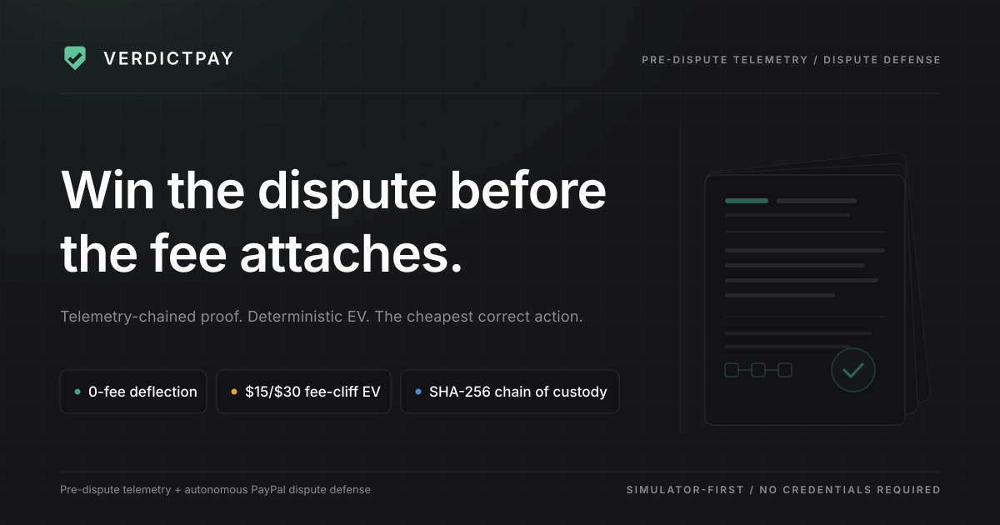
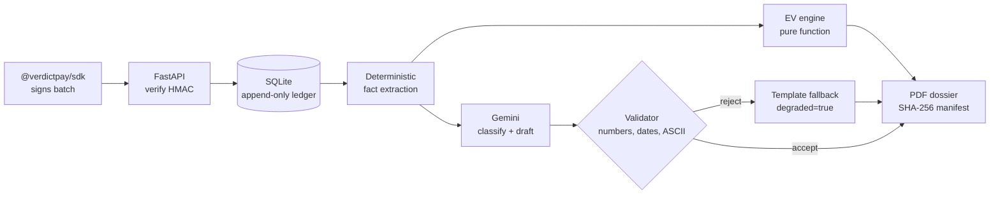

<div align="center">

<picture>
  <source media="(prefers-color-scheme: dark)" srcset="docs/assets/mark-ink.svg" />
  
</picture>

<h1>VerdictPay</h1>

<p><strong>Deterministic dispute economics, Gemini-drafted evidence, and a dossier a judge can verify.</strong></p>

<p>Pre-dispute telemetry and fee-cliff aware triage for PayPal digital-goods disputes.<br/>
Runs with PayPal sandbox credentials; no model key required for the default template path.</p>

<p><sub>Real PayPal Sandbox OAuth2 + orders &nbsp;·&nbsp; SHA-256 chained custody &nbsp;·&nbsp; MIT licensed</sub></p>

<p>
  
  
  
  
  
  <a href="LICENSE"></a>
</p>



</div>

**Jump to:** [overview](#1-product-overview) · [architecture](#2-architecture) ·
[setup](#3-setup) · [sandbox testing](#4-sandbox-testing) · [AI disclosure](#5-ai-disclosure) ·
[limitations](#6-limitations) · [verification](#7-verification)

---

## 1. Product overview

A merchant selling digital goods loses a PayPal dispute twice: they refund the sale, and they pay a
dispute fee whether or not they win. The fee is not a flat cost. PayPal charges **$15.00** per
chargeback normally, and **$30.00** once the merchant is classified high-volume. The $30.00 fee is
never refunded on a win, so winning a $25.00 claim nets **−$5.00** after the released funds.

Two thresholds make the timing matter more than the amount:

- **The 1.5% ratio cliff.** PayPal's high-volume classification keys off the dispute-to-sales ratio
  over a rolling 90 days. With 200 sales, the third dispute moves the ratio from 1.0% to 1.5% — onto
  the line — and the fee doubles from that dispute forward. A 3× penalty multiplier applies to the
  single dispute that crosses.
- **The 10-day response deadline.** Evidence must be assembled and filed before it, and the merchant
  is usually reconstructing account history from memory at that point.

Most disputes are winnable when the merchant can show the buyer accepted the terms, received the
goods, and used them. That evidence exists in application logs, but nothing links it to the buyer at
dispute time. The gap is not analytical, it is custodial.

VerdictPay closes it with three cooperating parts:

| Part | What it does | Why it can be trusted |
|---|---|---|
| **Deterministic EV triage** | Prices all four responses in dollars, including the fee cliff and the 3× penalty | Pure function of stored inputs; no model in the path |
| **Gemini-grounded evidence** | Classifies the buyer's claim and drafts a narrative from recorded facts | Every number in the draft is checked against the fact set; the model cannot set a figure |
| **Verifiable dossier** | Renders the case to PDF with a SHA-256 manifest over the bytes and the chain | Deterministic render; a judge can re-hash the file and compare |

The win probability is also deterministic: six weighted signals (ToS hash acceptance 0.15, IP match
0.12, delivery receipt 0.18, metered usage 0.15, verified chain 0.10, prior Visa CE 3.0 history in
the 120–365 day window 0.20) over a 0.10 base, scaled by a reason multiplier (not-received 1.00,
not-as-described 0.90, unauthorized 0.75, other 0.95) and clamped to 0.02–0.95.

## 2. Architecture

Three processes, no broker, no cloud dependency on the demo path.

- **Frontend** — Next.js 15 App Router, React 19, TypeScript, Tailwind 4. Pages: landing, the
  seven-step `/demo` workflow, disputes list and detail, customer timeline, analytics, settings,
  and the `/veto-lab` negative-control suite (CliffGuard: three executable controls against the
  isolated Sentinel, each with veto/allow provenance).
  One route handler (`/api/sdk/usage`) runs the SDK server-side so the HMAC signing secret never
  reaches the browser.
- **Backend** — FastAPI on Python 3.12, SQLAlchemy 2 async, SQLite by default (Postgres optional via
  `DATABASE_URL`). Pydantic v2 schemas, a single error envelope `{"error": {code, message, details,
  request_id}}`, request-id middleware, a body-size cap and an in-process rate limiter.
- **SDK** — [`@verdictpay/sdk`](https://www.npmjs.com/package/@verdictpay/sdk) on npm
  (`npm install @verdictpay/sdk`), a typed server-side client that signs and submits telemetry
  batches. Source and docs: [packages/verdictpay-sdk](packages/verdictpay-sdk).

### Gateway modes

One adapter boundary, two modes, chosen by `PAYPAL_MODE` and resolved in `backend/app/config.py`.
The sandbox gateway is the default path, so every order is a real sandbox order.

| `PAYPAL_MODE` | Talks to | Credentials | Order ids |
|---|---|---|---|
| `PAYPAL_SANDBOX` (default) | `https://api-m.sandbox.paypal.com` | `PAYPAL_SANDBOX_CLIENT_ID`/`SECRET`, or `PAYPAL_CLIENT_ID`/`SECRET` | PayPal-assigned |
| `PAYPAL_LIVE` | `https://api-m.paypal.com` | same, **plus** `ALLOW_PAYPAL_LIVE=true` | PayPal-assigned |

A network mode with missing credentials builds an `UnconfiguredGateway` rather than a live client.
The app still boots so `GET /health` can name what is missing in `gateway_status.blockers`, but every
payment call fails loudly. There is no offline fallback: a judge must never believe they are
watching a real PayPal call when they are not. `PAYPAL_LIVE` additionally fails validation unless
`ALLOW_PAYPAL_LIVE` is literally `true`.

### Order lifecycle

Every checkout traverses the same three stages in the sandbox path.

```
POST /api/v1/sandbox/checkout            -> CREATED    order exists, approval_url returned
        buyer approves in the PayPal UI   -> APPROVED   (open approval_url, approve as sandbox buyer)
POST /api/v1/sandbox/orders/{id}/capture -> CAPTURED   capture_id, transaction recorded
```

Capture is the only path that yields money. Calling capture before approval returns `409
order_not_approved`, mirroring PayPal's own 422 `ORDER_NOT_APPROVED`. In `PAYPAL_SANDBOX` the
`approval_url` is a real `https://www.sandbox.paypal.com/checkoutnow?token=…` URL — a human has to
open it and log in as the sandbox buyer. Buyer approval happens only in the PayPal UI.

### Deterministic EV engine

`backend/app/domain/disputes/ev.py` is a pure function over integer minor units and integer
parts-per-million (ppm). The policy constants live in `backend/app/oracle/rules_manifest.json`
(April 2026 thresholds), whose canonical SHA-256 is pinned in code and checked at boot: a missing,
float-bearing or edited manifest makes the API exit with code 2.

```python
# PayPal HVD (PAYPAL_WALLET only), 3 full calendar months, dollar-weighted
hvd_ratio_ppm   = disputed_wallet_inr_snad_claims_minor * 1_000_000 // net_sales_minor
in_hvd_tier     = settled_wallet_txns > 100 and hvd_ratio_ppm >= 15_000
fee             = 30.00 if in_hvd_tier else 15.00     # $30 REPLACES $15, never both
win_fee         = 30.00 if in_hvd_tier else 0.00      # HVD fee is charged even on a win
# an unescalated INQUIRY is not added to the ratio; only the fight path prices escalation
penalty         = (30.00 - 15.00) * 3 if stage == INQUIRY and fight_would_cross else 0.00
ev_fight        = p * (-win_fee) + (1 - p) * (-(amount + fee) - penalty)   # $100 loss: -$130 HVD, -$115 standard
ev_settle       = -amount if stage == INQUIRY else -(amount + fee)         # accept is $0 in INQUIRY
ev_offer        = -(0.30 * amount)                                         # amicable inquiry offer, $0 fee
```

Money is quantised with `ROUND_DOWN` (toward zero) so a ratio is never rounded up across a cliff;
ratios are reported as `ratio_*_ppm` integers plus exact six-place strings. Visa VAMP
(`(TC40 + TC15) / TC05 >= 15,000 ppm` and `>= 1,500` events, $8 per event) and Mastercard ECP are
computed by `app/oracle/cliff_engine.py` from a **simulated** acquirer feed and are always labelled
`[VISA-TC40 / ACQUIRER-FEED SIMULATION]` (`source_plane: "SIMULATED_CARD_NETWORK_FEED"`).

Tie-break order, when two actions price equally: `PROVIDE_EVIDENCE` → `DEFLECT_INQUIRY` →
`MAKE_OFFER` → `ACCEPT_CLAIM`, then lower fee.

### Policy versus cheapest

The engine's cheapest action and the triage policy's recommendation are reported separately, because
they legitimately differ. `decision.py` returns a three-row comparison — fight, settle, make offer —
each with its real modelled value, which row the policy chose, which row is cheapest, and whether
PayPal would currently accept that action. When the two disagree, `divergence_explanation` names both
and quantifies the gap in dollars.

Deflecting an inquiry is the documented example: it carries no fee, preserves the relationship and
avoids a chargeback, so policy may prefer it even when `MAKE_OFFER` prices lower. The API never claims
the recommendation *is* the cheapest outcome — it states which is which.

### Gemini layer

`GEMINI_MODEL` defaults to `gemini-2.5-flash`, called through the `google-genai` SDK at API version
`v1beta` (JSON mode is unavailable on `v1`). The model has exactly two jobs — classify the buyer's
claim into one of five categories, and draft the rebuttal narrative from the stored fact set. Both
outputs are schema-validated; the narrative is additionally checked for numeric containment, banned
phrasing and ASCII-only output before it is accepted. A rejected or failed draft falls back to the
deterministic template and the response says so. Section 5 is the full disclosure.

### Telemetry chain

Five event types — `TOS_ACCEPTED`, `SESSION_AUTH`, `ASSET_DELIVERED`, `USAGE_METERED`,
`AI_GENERATION` — are appended per payer in one ledger with no update or delete path.

```
payload_hash = sha256(canonical_json(payload))            # sorted keys, no whitespace, UTF-8
chain_hash   = sha256(f"{prev_hash}:{event_type}:{payer_id}:{created_at}:{payload_hash}")
```

`prev_hash` starts at `"0" * 64`. Verification recomputes every link and reports each break with its
sequence number, so tampering is localisable rather than merely detectable. Canonicalisation and the
chain formula live in `backend/app/domain/telemetry/hashing.py`.

### Dossier

`GET /api/v1/disputes/{id}/dossier.pdf` renders an A4 PDF with ReportLab in invariant mode, so the
same inputs produce byte-identical output. No fact is generated at render time — the renderer reads a
locked snapshot, which is what makes the hash meaningful. `GET …/dossier/manifest` returns the
SHA-256 over those bytes plus chain head and event count, and `GET …/dossier/verify` re-renders from
the same frozen snapshot and compares hashes, reporting `chain_valid`, `snapshot_present`,
`hash_matches` and `size_matches` individually. The `.pdf` response also carries `X-Dossier-SHA256`,
so a judge can compare a download against the manifest without trusting either.

### Request path



## 3. Setup

Requires Python 3.12+, Node 20+, [`uv`](https://docs.astral.sh/uv/) and `pnpm`. The database and
seed data are local SQLite. PayPal Sandbox credentials are required: see
[4.1 Get sandbox credentials](#41-get-sandbox-credentials). A Gemini key is optional; without one the
AI layer runs its labelled deterministic fallback.

```bash
git clone https://github.com/Divyanshu-kumar14/Verdict-Pay
cd Verdict-Pay
make install          # uv sync + pnpm install (frontend and SDK)
cp .env.example .env  # then set PAYPAL_SANDBOX_CLIENT_ID and PAYPAL_SANDBOX_CLIENT_SECRET
```

Backend, in one terminal:

```bash
make api              # uvicorn app.main:app on :8000, reload on
# or: uv run --directory backend uvicorn app.main:app --port 8000 --reload
```

Frontend, in a second terminal:

```bash
make web              # pnpm -C frontend dev → http://localhost:3000
```

`make stack` does both — it seeds the database, boots the API on `:8000`, runs the scripted demo as a
self-check, and stays up. `make demo` runs the demo and exits. API docs are at
`http://localhost:8000/docs`, health at `http://localhost:8000/api/v1/health`.

Docker is equivalent:

```bash
cp .env.example .env
docker compose up --build     # web on :3000, API on :8000
```

### Environment variables

Every variable below is documented in [.env.example](.env.example). Values shown are placeholders.

**Core**

| Name | Purpose | Example placeholder |
|---|---|---|
| `APP_ENV` | `local`, `test` or `production`; `production` rejects dev-default secrets | `local` |
| `DEMO_MODE` | Exposes the `/sandbox/*` helpers and the seeded demo merchant | `true` |
| `DATABASE_URL` | Async SQLAlchemy URL | `sqlite+aiosqlite:///./verdictpay.db` |
| `ALLOWED_ORIGINS` | Comma-separated CORS allow-list | `http://localhost:3000,http://127.0.0.1:3000` |
| `APP_NAME` | Service name in logs and OpenAPI | `VerdictPay API` |
| `API_V1_PREFIX` | Mount point for all routes | `/api/v1` |
| `REQUEST_ID_HEADER` | Correlation header read or assigned per request | `X-Request-Id` |
| `LOG_LEVEL` | Root log level | `INFO` |

**PayPal gateway**

| Name | Purpose | Example placeholder |
|---|---|---|
| `PAYPAL_MODE` | `PAYPAL_SANDBOX` or `PAYPAL_LIVE`. Any other value fails validation at boot | `PAYPAL_SANDBOX` |
| `PAYPAL_CLIENT_ID` | Sandbox/live app client id | `<your-paypal-sandbox-client-id>` |
| `PAYPAL_CLIENT_SECRET` | Sandbox/live app secret | `<your-paypal-sandbox-client-secret>` |
| `PAYPAL_WEBHOOK_ID` | Webhook id for signature verification | `<your-webhook-id>` |
| `PAYPAL_API_BASE` | Host override; empty resolves from the mode | `https://api-m.sandbox.paypal.com` |
| `ALLOW_PAYPAL_LIVE` | Second latch; must be `true` for `PAYPAL_LIVE` | `false` |
| `PAYPAL_RETURN_URL` | Where PayPal sends the buyer after approving | `http://localhost:3000/demo` |
| `PAYPAL_CANCEL_URL` | Where PayPal sends the buyer after cancelling | `http://localhost:3000/demo` |
| `PAYPAL_TIMEOUT_SECONDS` | Per-request HTTP timeout | `15` |
| `ALLOW_UNSIGNED_WEBHOOKS` | Accept unsigned webhooks (local testing only) | `false` |

**AI**

| Name | Purpose | Example placeholder |
|---|---|---|
| `GEMINI_API_KEY` | Enables the Gemini classify + draft path | `<your-google-ai-studio-key>` |
| `GEMINI_MODEL` | Gemini model id | `gemini-2.5-flash` |
| `AI_ENABLED` | Master switch; `false` forces deterministic mode | `true` |
| `AI_TIMEOUT_MS` | Per-call timeout | `12000` |
| `AI_MAX_RETRIES` | Retries before degrading | `1` |
| `LLM_MODE` | Dossier narrative provider: `template`, `openai`, `gemini` | `template` |
| `LLM_BASE_URL` | OpenAI-compatible base; point at Ollama for a local model | `http://localhost:11434/v1` |
| `LLM_MODEL` | Model id for that provider | `llama3.2` |
| `OPENAI_API_KEY` / `OPENAI_MODEL` | Used only when `LLM_MODE=openai` | `<key>` / `gpt-4o-mini` |

**Secrets and limits**

| Name | Purpose | Example placeholder |
|---|---|---|
| `VERDICTPAY_API_KEY` | Demo tenant key (public in the browser bundle by design) | `vp_demo_sk_local` |
| `VERDICTPAY_SIGNING_SECRET` | HMAC key for telemetry signatures | `openssl rand -hex 32` |
| `REQUIRE_SIGNED_TELEMETRY` | Reject unsigned batches; keep `true` | `true` |
| `WEBHOOK_TOLERANCE_SECONDS` | Replay window for signed timestamps | `300` |
| `RATE_LIMIT_PER_MINUTE` | In-process limiter, per key | `600` |
| `MAX_BODY_BYTES` | Request body cap | `262144` |
| `MAX_BATCH_EVENTS` | Events accepted in one telemetry batch | `500` |
| `ACTION_LATENCY_BUDGET_MS` | Budget the API reports against per action | `500` |
| `ARTIFACTS_DIR` | Where dossier PDFs are cached | `./artifacts` |
| `ELASTIC_URL` | Optional Elasticsearch mirror; empty disables it | `http://localhost:9200` |
| `ELASTIC_API_KEY` | Credential for that cluster | `<your-elastic-api-key>` |
| `ELASTIC_INDEX_PREFIX` | Index namespace | `verdictpay` |

**Demo identity** — fixed so the seeded run is reproducible. Changing any of these changes the
seeded demo identity used across the demo. Order ids are PayPal-assigned in sandbox mode.

| Name | Purpose | Default |
|---|---|---|
| `DEMO_MERCHANT_NAME` | Seeded merchant; its id is `mch_` + SHA-256 prefix | `Aurora Analytics` |
| `DEMO_PAYER_ID` | Seeded payer whose ledger the demo extends | `YRZ829104KLA` |
| `DEMO_ORDER_ID` | Historical order cited in seeded data | `5O190127TN364715T` |
| `DEMO_SUBSCRIPTION_ID` | Historical subscription cited in seeded data | `I-BW452GLLEP1G` |

**Frontend**

| Name | Purpose | Example placeholder |
|---|---|---|
| `NEXT_PUBLIC_API_BASE_URL` | Frontend → API base | `http://localhost:8000` |
| `NEXT_PUBLIC_VERDICTPAY_API_KEY` | Key bundled into the browser | `vp_demo_sk_local` |

The fee model itself is configurable but frozen in the demo: `STANDARD_FEE_USD=15.00`,
`HIGH_VOLUME_FEE_USD=30.00`, `RATIO_THRESHOLD=0.015`, `OFFER_RATIO=0.30`,
`HIGH_VOLUME_MIN_SALES=100`. Change any of them and every EV changes with it.

## 4. Sandbox testing

This is the judge path for real PayPal. It needs a free PayPal developer account and about five
minutes.

### 4.1 Get sandbox credentials

1. Sign in at <https://developer.paypal.com/dashboard/applications/sandbox>.
2. Create (or open) a **Sandbox** app and copy the **Client ID** and **Secret**.
3. Copy the **Sandbox** buyer account email and password from *Accounts* — you will need them to
   approve the order, and they are not the same as your real PayPal login.

Set them in `.env`:

```dotenv
PAYPAL_MODE=PAYPAL_SANDBOX
PAYPAL_CLIENT_ID=<your-paypal-sandbox-client-id>
PAYPAL_CLIENT_SECRET=<your-paypal-sandbox-client-secret>
PAYPAL_RETURN_URL=http://localhost:3000/demo
PAYPAL_CANCEL_URL=http://localhost:3000/demo
```

Restart the API and confirm the gateway is live before clicking anything:

```bash
curl -s http://localhost:8000/api/v1/health | python -m json.tool
# gateway_status.readiness == "ready", mode == "PAYPAL_SANDBOX", credentials_configured == true
```

If readiness is `unconfigured`, the `blockers` array names the exact missing variables. The API still
boots so `/health` can tell you what is wrong, but every payment call fails with a `502` that repeats
the blocker. Nothing is ever served offline behind a `PAYPAL_SANDBOX` label.

### 4.2 Prove the lifecycle from the command line

This script is the fastest way to see a real order on PayPal's side, independent of the UI:

```bash
./backend/.venv/bin/python backend/scripts/verify_paypal_sandbox.py --wait-for-approval 120
```

It performs four steps and prints each one: an OAuth2 client-credentials token against
`/v1/oauth2/token`, `POST /v2/checkout/orders` for USD 99.00 with `intent=CAPTURE`, an authoritative
`GET /v2/checkout/orders/{id}` re-read, and then the approval window. It polls every 5 seconds and
auto-captures as soon as the order leaves `CREATED`.

It refuses to run against a non-sandbox base (exit 2), never prints a token or secret, and never
fabricates a capture. If nobody approves within the window it exits **0** with an explicit `BLOCKER`
line and `"result": "pass_order_creation_capture_blocked"` — the order creation is genuinely proven
and the capture is honestly reported as not exercised. Evidence lands in
`artifacts/paypal-sandbox-proof.json` (newest run at the top level, up to ten earlier runs under
`runs`) and `artifacts/paypal-sandbox-proof.log`.

Exit codes: `0` verified (capture may be blocked), `1` network or upstream failure, `2` configuration
failure.

### 4.3 Walk the checkout in the browser

1. Open <http://localhost:3000/demo> and start a run. The demo issues `POST /sandbox/checkout` and
   shows the returned `approval_url`.
2. Open that URL — it is a real `sandbox.paypal.com` checkout page. Log in with the **sandbox buyer**
   credentials and approve.
3. Back in the app, capture. `POST /sandbox/orders/{id}/capture` now returns `CAPTURED` with a `capture_id`,
   and the order detail shows `lifecycle_stage: CAPTURED`.
4. If you capture before approving, the API returns `409 order_not_approved`. That is the lifecycle
   working, not a bug.

Capture requires prior sandbox-buyer approval: open the approval_url, log in as the sandbox buyer, approve, then capture.

### 4.4 Trigger events and inspect the result

```bash
# create an order first; the response carries order_id
curl -s -X POST localhost:8000/api/v1/sandbox/checkout \
  -H 'content-type: application/json' \
  -H 'X-API-Key: vp_demo_sk_local' \
  -d '{"plan":"pro","payer_id":"YRZ829104KLA"}' | python -m json.tool

# usage telemetry: four chained events for the payer (order_id is required)
curl -s -X POST localhost:8000/api/v1/sandbox/usage \
  -H 'content-type: application/json' \
  -H 'X-API-Key: vp_demo_sk_local' \
  -d '{"payer_id":"YRZ829104KLA","order_id":"<order_id from checkout>"}' | python -m json.tool

# open a dispute on that order; the response carries dispute.dispute_id and origin
curl -s -X POST localhost:8000/api/v1/sandbox/dispute \
  -H 'content-type: application/json' \
  -H 'X-API-Key: vp_demo_sk_local' \
  -d '{"payer_id":"YRZ829104KLA","order_id":"<order_id from checkout>","claim_text":"I never received the export I paid for."}' \
  | python -m json.tool
```

`POST /sandbox/dispute` first asks PayPal's Disputes API to create the dispute. A standard sandbox
app is not allowed to (PayPal answers `401`), so the API then builds the dispute itself and labels it
`origin: "internal_test_event"`. A dispute PayPal did create is labelled `origin: "paypal_sandbox"`.
See [Limitations](#6-limitations).

To receive real PayPal dispute webhooks instead, the API needs a public URL (a Render deploy or a
tunnel such as `ngrok http 8000`). Subscribe your sandbox app's webhook to the `CUSTOMER.DISPUTE.*`
events at `https://<public-host>/api/v1/webhooks/paypal`, and set `PAYPAL_SANDBOX_WEBHOOK_ID` to the
webhook id PayPal shows. Every delivery is checked with PayPal's `verify-webhook-signature` API and
de-duplicated on its event id. The `/demo` dispute step uses a webhook dispute for the order when one
has arrived, and otherwise calls `POST /sandbox/dispute`.

### 4.5 Run the AI analysis and the integrity checks

```bash
# use the dispute_id returned by /sandbox/dispute (or any id from GET /api/v1/disputes)
DISPUTE=<dispute_id>

# Gemini classifies the claim and drafts the rebuttal; EV stays deterministic
curl -s -X POST localhost:8000/api/v1/disputes/$DISPUTE/ai/analyze \
  -H 'content-type: application/json' \
  -H 'X-API-Key: vp_demo_sk_local' \
  -d '{"claim_text":"I never received the export I paid for."}' | python -m json.tool

# verify the ledger for a payer
curl -s -H 'X-API-Key: vp_demo_sk_local' localhost:8000/api/v1/telemetry/chain/YRZ829104KLA/verify | python -m json.tool

# manifest, download, verify
curl -s -H 'X-API-Key: vp_demo_sk_local' localhost:8000/api/v1/disputes/$DISPUTE/dossier/manifest | python -m json.tool
curl -s -H 'X-API-Key: vp_demo_sk_local' -o /tmp/dossier.pdf -D - localhost:8000/api/v1/disputes/$DISPUTE/dossier.pdf
shasum -a 256 /tmp/dossier.pdf     # compare with manifest.sha256 and X-Dossier-SHA256
curl -s -H 'X-API-Key: vp_demo_sk_local' localhost:8000/api/v1/disputes/$DISPUTE/dossier/verify | python -m json.tool
```

### 4.6 Run the test suites

```bash
make test                 # backend (pytest) + frontend (vitest) + SDK
make test-backend         # uv run --directory backend pytest -q
make test-frontend        # pnpm -C frontend test --run
make test-sdk             # pnpm -C packages/verdictpay-sdk test
make test-e2e             # frontend HTTP contract + judge-flow suite, needs a running API
make verify               # full gate: ruff, pytest, eslint, tsc, vitest, next build, SDK, demo
```

`pytest` must run from `backend/` — `make test-backend` handles that. Run from the repository root it
fails collection with `ModuleNotFoundError: No module named 'app'`.

## 5. AI disclosure

VerdictPay uses **Google Gemini**, `gemini-2.5-flash` by default, configured by `GEMINI_MODEL`. The
governing rule is in the module docstring: *AI explains and drafts; rules decide.*

**What Gemini does**

- **Claim classification.** Reads the buyer's free-text claim and returns one of five categories
  (`not_as_described`, `unauthorized`, `not_received`, `duplicate`, `other`) with a confidence and a
  one-line rationale. The claim text is passed as untrusted input; the prompt instructs the model to
  ignore instructions inside it.
- **Narrative drafting.** Writes the seller's rebuttal prose from the stored fact set — dates,
  delivery records, usage counts, the accepted ToS hash. Output is capped at 1,800 characters and
  must satisfy the validator: every number and date must appear in the fact set, banned phrasing is
  rejected, non-ASCII is rejected.
- **Plain explanation.** The "why this recommendation" paragraph is *not* model-written. It is
  rendered by a deterministic formatter over the EV breakdown, because a formula explanation cannot
  hallucinate a coefficient.

**What Gemini never controls**

- Win probability — the weighted deterministic function in `win_probability.py`.
- Any EV figure, fee, penalty, offer amount or the recommended action — `ev.py`, a pure function.
- PayPal eligibility, protection outcomes or whether a dispute is winnable in reality.
- Whether the case exists, its stage, its deadline, or any stored fact.

The model's output is bounded input to a template, not a decision. Concretely, `POST
/disputes/{id}/ai/analyze` computes `build_detail()` first and the model is only reached afterwards;
a 404 or a deterministic failure never invokes it at all.

**Degraded mode is always labelled.** Every AI response carries `degraded` and `degraded_reason`,
and the UI shows a badge when either is set:

| `degraded_reason` | Meaning |
|---|---|
| `ai_disabled` | No `GEMINI_API_KEY`, or `AI_ENABLED=false`. Deterministic classifier and template narrative. |
| `model_error` | The call failed or timed out. The exception type is included. |
| `model draft fell back to template` | Gemini answered but the draft failed validation. |

In all three cases the analysis is still correct — classification falls back to a keyword table and
the narrative to a deterministic template — and the response says which path ran. The dossier footer
stamps provenance as `Narrative source: ai:<model>` or `Narrative source: template`, so a printed
dossier cannot overstate what produced it. Each successful generation also appends an `AI_GENERATION`
event to the telemetry chain, which is why AI use is auditable rather than inferred.

Full detail, including the exact prompt contract and validation rules, is in
[docs/ai-disclosure.md](docs/ai-disclosure.md).

## 6. Limitations

Stated plainly, because a judge should not have to discover these.

- **Sandbox capture needs a human.** Buyer approval in `PAYPAL_SANDBOX` requires a person to open the
  `approval_url` and log in as the sandbox buyer. No amount of scripting removes that step, and the
  verification script reports `capture BLOCKED` when it does not happen rather than inventing one.
- **The internal test dispute is not a PayPal dispute.** PayPal does not let a standard sandbox app
  create disputes through the API, so `POST /sandbox/dispute` usually builds one locally, labelled
  `origin: "internal_test_event"`. It runs through the same triage, EV, AI and dossier code as a real
  dispute, but PayPal has never seen it. Its seller actions (send message, offer, accept, evidence
  upload) are therefore recorded as `SKIPPED` with the reason, not sent to PayPal. Only a webhook
  delivered by PayPal, or a dispute PayPal's API created, is labelled `paypal_sandbox`.
- **Subscription containment needs a real subscription.** The demo payer's fallback subscription id
  does not exist in your sandbox, so containment on a demo dispute reports `suspended: false` with
  PayPal's error rather than claiming a suspension.
- **Impact metrics are exact aggregates, not PayPal observations.** `fees_avoided_usd` counts
  one active-tier fee per INQUIRY case closed amicably after an executed SEND_MESSAGE or MAKE_OFFER
  (the seeded historical inquiry contributes one $15.00); `protected_usd` sums open-case amounts with
  a protected recommendation; `win_rate_estimate` averages confident p(win) scores. They are computed
  from the seeded case set, not observed PayPal outcomes.
- **The win probability is a prior, not a prediction.** The weights are a hand-set, documented model.
  They are not fitted to real dispute outcomes, and they should not be read as a calibrated forecast.
- **`PAYPAL_SANDBOX` is the default (sandbox credentials required).** Order ids and captures are PayPal-assigned sandbox values. The seeded sales history and CE 3.0 lookback rows are synthetic and labelled `source: "seed"`.
- **Single merchant, single tenant.** One demo merchant, one API key. There is no multi-tenant
  isolation, no user accounts, and no per-customer authorisation.
- **SQLite is the demo store.** Concurrent write behaviour is SQLite's; Postgres is supported by
  `DATABASE_URL` but the demo does not exercise it.
- **The rate limiter is per process.** A multi-replica deployment would need a shared limiter.
- **Elasticsearch is optional and off the demo path.** If `ELASTIC_URL` is unset the search adapter is
  a null implementation and SQL remains the only source of truth.
- **Bryntum and AG Studio are not used.** AG Grid Community (`ag-grid-community` 34.3.1) powers the
  disputes table; the Bryntum scheduler and AG Studio tooling are not part of this build.
- **Sponsor & deployment tooling included.** Render Blueprint ([render.yaml](render.yaml),
  [docs/deploy-render.md](docs/deploy-render.md)) hosts the live frontend and API, and
  [postman/](postman) provides an importable Postman collection and local environment for the API.

## 7. Verification

Every claim above is reproducible with these commands. Artifacts are written to `artifacts/`, which
is gitignored, so a fresh clone regenerates rather than inherits them.

| What to check | Command |
|---|---|
| Backend tests | `make test-backend` |
| Frontend tests | `make test-frontend` |
| SDK tests | `make test-sdk` |
| End-to-end browser tests | `make test-e2e` |
| Lint and types | `make lint` and `make typecheck` |
| Full gate incl. scripted demo | `make verify` |
| Real PayPal Sandbox lifecycle | `./backend/.venv/bin/python backend/scripts/verify_paypal_sandbox.py --wait-for-approval 120` |
| Ledger integrity | `curl -s -H 'X-API-Key: vp_demo_sk_local' localhost:8000/api/v1/telemetry/chain/YRZ829104KLA/verify` |
| Dossier integrity | `curl -s -H 'X-API-Key: vp_demo_sk_local' localhost:8000/api/v1/disputes/<dispute_id>/dossier/verify` |

Evidence artifacts:

| Path | Contents |
|---|---|
| `artifacts/paypal-sandbox-proof.json` | Machine-readable PayPal proof: API base, mode, order id, status, approval URL, `debug_id`, and an explicit `blocker` field when capture was not exercised |
| `artifacts/paypal-sandbox-proof.log` | Human-readable run with each of the four steps and the polling window |
| `artifacts/PP-D-*.pdf` | Rendered dossiers, byte-identical for identical inputs |
| `backend/.pytest_cache/`, `frontend/.qa/` | Test run metadata and recorded QA output |

A dossier can be verified without trusting the server: download the PDF, take its SHA-256, and
compare it against `manifest.sha256` and the `/dossier/verify` result. All three must agree.
`curl` can also read the `X-Dossier-SHA256` response header, which carries the same digest as the
manifest; a browser cannot, because the API exposes only `X-Request-Id` through CORS. The manifest
also carries `chain_head` and `event_count`, so the same file ties back to the ledger.

```bash
curl -sD - -o /tmp/d.pdf localhost:8000/api/v1/disputes/<dispute_id>/dossier.pdf \
  -H 'X-API-Key: vp_demo_sk_local' | grep -i x-dossier-sha256
shasum -a 256 /tmp/d.pdf
```

Related documentation: [architecture](docs/architecture.md) · [architecture decisions](docs/adr/) ·
[demo script](docs/demo.md) · [AI disclosure](docs/ai-disclosure.md) ·
[sandbox mode](docs/live-mode.md) · [deployment](docs/deploy-render.md) ·
[Postman collection](postman/verdictpay-api.postman_collection.json).

## License

MIT. See [LICENSE](LICENSE).
