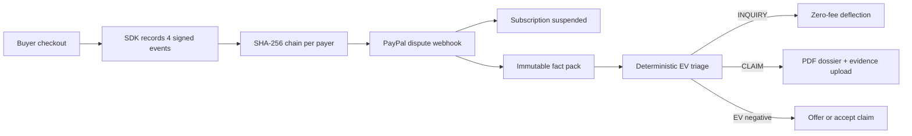

<div align="center">


<h1>VerdictPay</h1>

<p><strong>Win the dispute before the fee attaches.</strong></p>

<p>Pre-dispute telemetry, deterministic dispute pricing and an AI rebuttal that cannot
invent a number, built for PayPal digital-goods merchants.</p>

<p><code>291 backend tests</code> &nbsp;·&nbsp; <code>26 end-to-end assertions</code> &nbsp;·&nbsp;
<code>zero API keys to run the demo</code></p>

<p>
  <a href="LICENSE"></a>
  
  
  
  
  
</p>

</div>

A working prototype, not a hosted service. It runs on a laptop with no PayPal credentials, no model
key and no cloud account, and the demo path is the tested path.

**Jump to:** [why this exists](#why-this-exists) · [the demo](#the-60-second-demo) ·
[how it works](#how-it-works) · [quickstart](#quickstart) · [API](#api-surface) ·
[verification](#verification) · [limitations](#honest-limitations)

## Why this exists

PayPal's January 2026 seller-protection rules assume the seller ships a box. SaaS, digital goods and metered AI products ship bytes and API calls, so the standard evidence packet has nothing to attach to.

| Gap | What the rule asks for | What it costs the merchant |
|---|---|---|
| **SNAD is outside seller protection** | A receipt proves payment, not that the product was consumed | No evidence route at all for a delivered download or an API call |
| **INR and UNAUTHORIZED need a system of record** | IP, device, delivery time and access proof | The merchant reconstructs that history after the claim has already landed |
| **Card-funded chargebacks follow Visa CE 3.0** | Two or more prior undisputed transactions sharing an IP or device | History most subscription products never keep in an admissible shape |
| **The $15 / $30 fee cliff** | A fee attaches when a claim escalates; the $30 high-volume fee is never refunded, even on a win | A cheap claim can cost more to defend than to refund |
| **Subscription bleed** | An open chargeback on a live subscription | A second chargeback within 30 days, with access still provisioned |

Fight a $25 claim, win it, and the high-volume fee still lands: +$25 released, -$30 fee, net -$5. With 200 sales in the trailing 90 days, the third dispute moves the rolling ratio from 1.0% to 1.5%, exactly onto PayPal's high-volume threshold; the seeded queue then sits at 2.5–3.0%, so every later fight carries a fee that never comes back. The engine prices that crossing before the action, not after.

## The 60-second demo

Two panes: a buyer storefront on the left, the merchant command center on the right. Seed, boot, open `http://localhost:3000` and click in order. Every value on the right is served by the API; none of it is a static panel.

| Button | What appears on the right |
|---|---|
| **1 · Checkout $99 Pro plan** | Orders v2 creates order `5O14B26DBBB1A5529` and subscription `I-BW2BDCA160D9` for payer `YRZ829104KLA`; the SDK binds that payer to the SHA-256 of the Terms of Service the buyer accepted |
| **2 · Simulate usage** | Four signed events append to the ledger: 8 rows, `logins=15`, `tokens=42,000`, `assets=1`, chain verified |
| **3 · File friendly-fraud dispute** | Case `PP-D-40006` on the SNAD · INQUIRY path; subscription suspended in 0–1 ms; p(win) 90.0%, EV fight -$41.40, settle -$99.00, offer -$29.70, recommendation `DEFLECT_INQUIRY` at a $0.00 fee |

The recommendation is not the best raw EV card. In an INQUIRY with complete telemetry the policy takes the zero-fee, evidence-backed message first, because it cannot attract the claim fee and can end the case before escalation. The CLI variant, `make demo`, files INR instead of SNAD and asserts p(win) 95.0% and EV fight -$35.70; both numbers are computed live. There is no hosted URL: the demo runs locally in simulator mode with zero keys, and the numbers above are asserted by [e2e_demo.py](backend/scripts/e2e_demo.py) and documented in [demo.md](docs/demo.md).

## How it works

VerdictPay ingests signed lifecycle events from the merchant's product, links them into a per-payer hash chain, and treats that chain as the system of record PayPal asks for. When a case opens, through the webhook or the sandbox button, it persists the dispute, suspends the recurring subscription inside a bounded, failure-isolated timeout, locks an immutable fact pack, and prices fight, settle and offer with pure functions. The action it takes is filtered by PayPal's returned HATEOAS links, so an action the API would reject is never attempted. Deterministic code decides the money; an optional model writes the prose last.

FastAPI on Python 3.12+ with async SQLAlchemy (SQLite by default, Postgres through `DATABASE_URL`), a TypeScript SDK, and a Next.js 15 / React 19 / Tailwind 4 / AG Grid Community command center.



### Telemetry ledger

The SDK records four event types keyed to the PayPal payer id: `TOS_ACCEPTED` with the SHA-256 of the exact text shown, `SESSION_AUTH` with IP and device, `ASSET_DELIVERED` with the resource and its SHA-256, and `USAGE_METERED`. Rows are deduplicated by `event_id` and appended to a per-payer chain:

```text
payload_hash = sha256(canonical_json(payload))
chain_hash   = sha256(prev_hash : event_type : payer_id : created_at : payload_hash)
```

Verification recomputes every row and reports the exact sequence number that breaks, not a boolean. The ledger is append-only; the frozen contract lives in [hashing.py](backend/app/domain/telemetry/hashing.py) and the append path in [service.py](backend/app/domain/telemetry/service.py).

### Deterministic EV

Win probability is a deterministic score over six telemetry signals: ToS hash +0.15, IP match +0.12, delivery receipt +0.18, metered usage +0.15, verified chain +0.10 and Visa CE 3.0 history +0.20, on a 0.10 base, multiplied by reason (INR 1.00, SNAD 0.90, UNAUTHORIZED 0.75) and clamped to 0.02–0.95.

```text
ev_fight  = p * (-Fh) + (1 - p) * (-A - Fs - Fh - penalty)
ev_settle = -(A + 15) once a claim fee attaches, else -A
ev_offer  = -0.30 * A

Fs      = 15    standard fee, refundable on a win only if it attached
Fh      = 30    high-volume fee, never refunded
penalty = 3 * 30, only on the dispute that crosses the 1.5% ratio
```

All amounts are `Decimal`, quantized to cents; every function is pure and unit-tested to the cent in [ev.py](backend/app/domain/disputes/ev.py) and [win_probability.py](backend/app/domain/disputes/win_probability.py).

### AI air-gap

A locked fact pack is built from the ledger and Reporting v1 transactions, serialized and frozen. Only then does the narrative provider run: one OpenAI-compatible `/chat/completions` call at temperature 0, against a hosted model or a local Ollama endpoint through `LLM_BASE_URL` and `LLM_MODEL`. The validator scans the output token by token and rejects any number or date absent from the facts, banned phrases and non-ASCII text; any failure, including no key at all, falls back to the deterministic template.

```bash
# free, offline AI - no paid key
ollama pull llama3.2
LLM_MODE=openai LLM_BASE_URL=http://localhost:11434/v1 LLM_MODEL=llama3.2 make stack
```

ReportLab renders a three-page, byte-reproducible PDF, which goes to PayPal as `multipart/related`. The dossier footer stamps `Narrative source: ai:<model>` or `Narrative source: template`. The model never touches EV, p(win), chain hashes or PDF layout, and a test asserts the API key never appears in the rendered document. The fence is [narrative.py](backend/app/domain/evidence/narrative.py); the renderer is [pdf.py](backend/app/domain/evidence/pdf.py).

## What makes it different

- **The price is decided before a word is written.** [ev.py](backend/app/domain/disputes/ev.py) runs first and the fact pack freezes; only then may a model draft. The validator rejects any figure that is not in that pack, so prose cannot move the money.
- **Illegal actions are unrepresentable.** Triage intersects the case stage with PayPal's returned `links[]` before ranking EV ([state_machine.py](backend/app/domain/disputes/state_machine.py)), so the UI never offers, and the client never sends, an action PayPal would reject.
- **Tamper detection names the row.** Chain verification recomputes each hash and returns the broken sequence number ([hashing.py](backend/app/domain/telemetry/hashing.py)); one mutated row is reported where it broke, not hidden behind a pass/fail badge.
- **The fee cliff is priced, not mentioned.** `high_volume` requires 100+ trailing-90-day sales and a post-dispute ratio of at least 1.5%; the crossing dispute carries a $30 fee and $90 of three-dispute penalty exposure, and the EV card shows it.
- **The demo path is the tested path.** [live.py](backend/app/integrations/paypal/live.py) implements OAuth2, Disputes v1, Orders v2, Subscriptions v1, Reporting v1 and webhook verification; the simulator satisfies the same `PayPalGateway` protocol ([protocol.py](backend/app/domain/protocols.py)), and the 26 end-to-end assertions drive the webhook, containment, EV and evidence upload through it.

## Quickstart

Requires Python 3.12+, Node 20+, `uv` and `pnpm`. SQLite, seed data and the PayPal simulator are local.

```bash
git clone https://github.com/Divyanshu-kumar14/Verdict-Pay
cd Verdict-Pay
make install
make stack      # seeds the database, boots the API on :8000, asserts the flow, stays up
make web        # second terminal -> http://localhost:3000
```

The API docs are at `http://localhost:8000/docs`. Docker is equivalent:

```bash
cp .env.example .env
docker compose up --build
# http://localhost:3000 · API docs http://localhost:8000/docs
```

Proof without leaving a server behind:

```bash
make demo     # seed, boot, run the 26 assertions, shut down
make verify   # the full gate
```

## API surface

<details>
<summary>15 endpoints and one error envelope</summary>

| Method | Path | Purpose |
|---|---|---|
| GET | `/api/v1/health` | Version and active gateway mode |
| POST | `/api/v1/telemetry/events` | HMAC-signed batch ingest |
| GET | `/api/v1/telemetry/chain/{payer_id}/verify` | Recompute the chain and report any break |
| GET | `/api/v1/customers/{payer_id}/timeline` | Ordered events, aggregates and chain proof |
| POST | `/api/v1/sandbox/checkout` | Orders v2 checkout plus subscription |
| POST | `/api/v1/sandbox/usage` | Four chained telemetry events |
| POST | `/api/v1/sandbox/dispute` | Open a case through the real webhook path |
| POST | `/api/v1/webhooks/paypal` | Signature-verified, replay-safe ingest |
| GET | `/api/v1/disputes` | Paginated triage queue |
| GET | `/api/v1/disputes/{id}` | Case room: EV, signals, facts and allowed actions |
| POST | `/api/v1/disputes/{id}/triage` | Recompute the decision |
| POST | `/api/v1/disputes/{id}/actions/{action}` | `SEND_MESSAGE`, `MAKE_OFFER`, `ACCEPT_CLAIM`, `PROVIDE_EVIDENCE` |
| GET | `/api/v1/disputes/{id}/dossier.pdf` | Byte-reproducible evidence dossier |
| GET | `/api/v1/reporting/summary` | Exposure, fees avoided and the rolling dispute ratio |
| GET | `/api/v1/reporting/transactions` | Cached transaction history (CE 3.0 lookback) |

Errors use one envelope:

```json
{"error": {"code": "illegal_dispute_action", "message": "...", "details": [], "request_id": "..."}}
```

</details>

## Security model

- **SDK to API:** HMAC-SHA256 over `<timestamp>.<raw body>` in `X-VerdictPay-Timestamp` and `X-VerdictPay-Signature`, a ±300 s window, `event_id` dedupe, and signing required by default ([security.py](backend/app/security.py)).
- **PayPal to API:** `verify-webhook-signature` in live mode; unsigned traffic is rejected unless explicitly enabled in a local profile.
- **Secrets:** environment only, redacted from logs, and the app refuses to boot in production with the documented development defaults ([config.py](backend/app/config.py)).
- **Ingest and output:** 256 KB bodies, 500 events per batch, per-merchant rate limits, and a test that asserts the API key never appears in the rendered dossier.

## Verification

```bash
make verify        # ruff, 291 pytest, eslint, tsc, next build, 24 SDK tests, 26 E2E assertions
make demo          # the judge flow alone, exits
make verify-live   # live PayPal sandbox check, needs PAYPAL_MODE=live and credentials
```

Backend: 291 pytest tests. SDK: 24 vitest tests. End to end: 26 assertions against the running simulator. Frontend: eslint, `tsc --noEmit` and `next build` green across six routes (/, /disputes, /disputes/[id], /timeline, /analytics, /settings).

## Sponsor tooling, honestly

| Tool | What this repository actually does |
|---|---|
| **PayPal** | Live clients for Disputes v1, Orders v2, Subscriptions v1, Reporting v1 and webhook verification, plus a protocol-identical simulator for the keyless demo. |
| **AG Grid** | Community grid powers the triage queue and the analytics table. |
| **APIMatic** | The PayPal client follows the official OpenAPI shapes; every request and response is Pydantic-validated. |
| **Postman** | [postman/](postman) collection and environment covering telemetry, webhook, dispute and evidence calls. |
| **Render** | [render.yaml](render.yaml) blueprint for API and web. Not deployed from this checkout. |
| **Elastic** | Optional search adapter behind an interface; not on the demo path, SQL stays authoritative. |
| **Bryntum / AG Studio** | Not licensed, not bundled and not emulated. The SLA board is a Bryntum-shaped React/CSS timeline; analytics uses AG Grid Community. We say so instead of faking a license. |

## Honest limitations

- **The simulator is the default.** `PAYPAL_MODE=simulator` needs no PayPal account, credentials or network. It proves the pipeline, not PayPal's production behaviour.
- **Live mode is fixture-tested only.** The client is real code against the published REST contracts, but no live sandbox transaction was run from this checkout; the tests replay recorded HTTP fixtures. `make verify-live` runs the check when credentials exist.
- **Bryntum and AG Studio are not used.** Neither runtime is licensed or bundled. The timeline renders a Bryntum-shaped data model with React and CSS, and analytics uses AG Grid Community; the repository says this instead of faking a license.
- **The Elastic adapter is optional and off the demo path.** It is selected only when `ELASTIC_URL` is set; SQL stays authoritative and the demo never needs a cluster.
- **The demo is single-merchant.** One seeded merchant and one API key; `merchant_id` is carried through the schema, but multi-tenant key derivation is not wired.

Claim-by-claim detail, including what is deliberately *not* claimed, is in
[sponsors.md](docs/sponsors.md).

## Hackathon

Built for the PayPal AI Hackathon, October 1 to November 12, 2026. The submission text, tools list, video script and judge run instructions are in [submission.md](docs/submission.md); the requirement-by-requirement audit, including the items still open, is in [hackathon-compliance.md](docs/hackathon-compliance.md).

## License

MIT. See [LICENSE](LICENSE).

<div align="center">
  <sub>Built with FastAPI, Next.js and a healthy distrust of anything a language model says about money.</sub>
</div>
