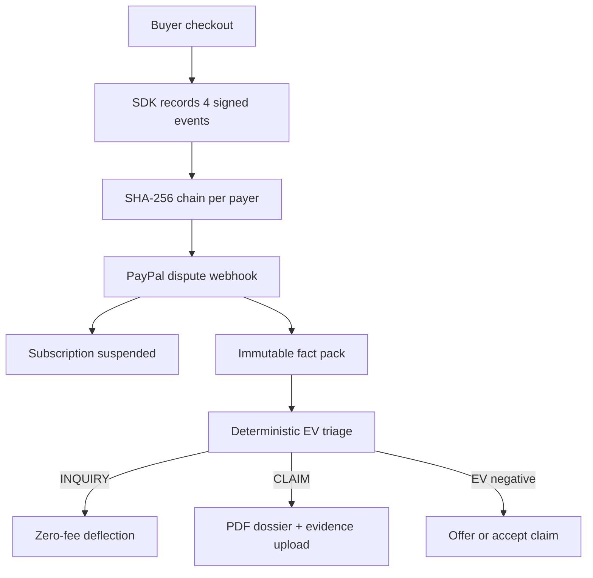
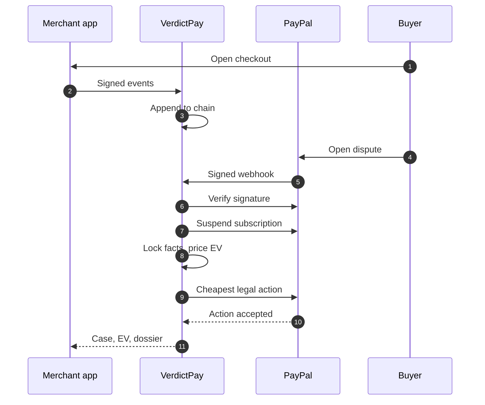

<div align="center">

<picture>
  <source media="(prefers-color-scheme: dark)" srcset="docs/assets/mark-ink.svg" />
  
</picture>

<h1>VerdictPay</h1>

<p><strong>Hash-chained proof, deterministic pricing, and an AI that cannot invent a number.</strong></p>

<p>Pre-dispute telemetry for PayPal digital-goods disputes.<br/>
Runs locally: no PayPal account, no model key, no cloud.</p>

<p><sub>520 tests &nbsp;·&nbsp; 26 end-to-end assertions &nbsp;·&nbsp; MIT licensed</sub></p>

<p>
  
  
  
  
  
  <a href="LICENSE"></a>
</p>


</div>

**Jump to:** [quickstart](#quickstart) · [the demo](#the-60-second-demo) ·
[why this exists](#why-this-exists) · [how it works](#how-it-works) ·
[the AI air-gap](#the-ai-air-gap) · [API](#api-surface) · [limitations](#honest-limitations)

## Quickstart

**No install:** the judge demo is live at <https://verdictpay-web.onrender.com> (API:
<https://verdictpay-api.onrender.com>). The free tier sleeps after ~15 minutes idle — open the
API's [`/api/v1/health`](https://verdictpay-api.onrender.com/api/v1/health) first to wake it,
then the web app.

To run it locally, you need Python 3.12+, Node 20+, `uv` and `pnpm`. SQLite, seed data and the
PayPal simulator are local.

```bash
git clone https://github.com/Divyanshu-kumar14/Verdict-Pay
cd Verdict-Pay
make install
make stack      # seeds the database, boots the API on :8000, asserts the flow, stays up
make web        # second terminal -> http://localhost:3000
```

The API docs are at `http://localhost:8000/docs`. Docker is equivalent:

```bash
cp .env.example .env
docker compose up --build
# http://localhost:3000 · API docs http://localhost:8000/docs
```

Proof without leaving a server behind:

```bash
make demo     # seed, boot, run the 26 assertions, shut down
make verify   # the full gate
```

### Live PayPal sandbox (optional)

The demo never needs credentials. To exercise the same gateway against a real PayPal sandbox
account, put them in a gitignored `.env` and run the live check — it forces `PAYPAL_MODE=live`
for that command only, so `make stack` stays deterministic:

```bash
make env                      # copy the template, then fill in the two values
# PAYPAL_CLIENT_ID=...  PAYPAL_CLIENT_SECRET=...
make verify-live              # OAuth, dispute read, Reporting v1 lookback
```

Never commit `.env`; it is ignored by git and by the Docker build context. Reporting v1 caps a
query at 31 days and rejects `payer_id` as a filter, so the live client chunks the CE 3.0
lookback and filters locally — see [docs/live-mode.md](docs/live-mode.md).

## The 60-second demo

Two panes: a buyer storefront on the left, the merchant command center on the right. Seed, boot, open `http://localhost:3000` and click in order. Every value on the right is served by the API; none of it is a static panel.

| Button | What appears on the right |
|---|---|
| **1 · Checkout $99 Pro plan** | Orders v2 creates order `5O14B26DBBB1A5529` and subscription `I-BW2BDCA160D9` for payer `YRZ829104KLA`; the SDK binds that payer to the SHA-256 of the Terms of Service the buyer accepted |
| **2 · Simulate usage** | Four signed events append to the ledger: 8 rows, `logins=15`, `tokens=42,000`, `assets=1`, chain verified |
| **3 · File friendly-fraud dispute** | Case `PP-D-40006` on the SNAD · INQUIRY path; subscription suspended in 0–1 ms; p(win) 90.0%, EV fight -$41.40, settle -$99.00, offer -$29.70, recommendation `DEFLECT_INQUIRY` at a $0.00 fee |

The recommendation is not the best raw EV card. In an INQUIRY with complete telemetry the policy takes the zero-fee, evidence-backed message first, because it cannot attract the claim fee and can end the case before escalation. The CLI variant, `make demo`, files INR instead of SNAD and asserts p(win) 95.0% and EV fight -$35.70; both numbers are computed live. There is no hosted URL: the demo runs locally in simulator mode with zero keys, and the numbers above are asserted by [e2e_demo.py](backend/scripts/e2e_demo.py) and documented in [demo.md](docs/demo.md).

## Why this exists

PayPal's January 2026 seller-protection rules assume the seller ships a box. SaaS, digital goods and metered AI products ship bytes and API calls, so the standard evidence packet has nothing to attach to.

| Gap | What the rule asks for | What it costs the merchant |
|---|---|---|
| **SNAD is outside seller protection** | A receipt proves payment, not consumption | No evidence route for a download or an API call |
| **INR / UNAUTHORIZED need a system of record** | IP, device, delivery time and access proof | History gets rebuilt after the claim lands |
| **Card-funded chargebacks follow Visa CE 3.0** | Two prior undisputed transactions sharing IP or device | Most subscriptions never keep that history |
| **The $15 / $30 fee cliff** | The $30 fee is never refunded, even on a win | A cheap claim can cost more to defend than to refund |
| **Subscription bleed** | An open chargeback on a live plan | A second chargeback 30 days later, access still on |

Fight a $25 claim, win it, and the high-volume fee still lands: +$25 released, -$30 fee, net -$5. With 200 sales in the trailing 90 days, the third dispute moves the rolling ratio from 1.0% to 1.5%, exactly onto PayPal's high-volume threshold; the seeded queue then sits at 2.5–3.0%, so every later fight carries a fee that never comes back. The engine prices that crossing before the action, not after.

## How it works

VerdictPay ingests signed lifecycle events from the merchant's product, links them into a
per-payer hash chain, and treats that chain as the system of record PayPal asks for. When a case
opens, it persists the dispute, suspends the recurring subscription inside a bounded,
failure-isolated timeout, locks an immutable fact pack, and prices fight, settle and offer with
pure functions.

The action it takes is filtered by PayPal's returned HATEOAS links, so an action the API would
reject is never attempted. Deterministic code decides the money; an optional model writes the
prose last.

FastAPI on Python 3.12+ with async SQLAlchemy (SQLite by default, Postgres through `DATABASE_URL`), a TypeScript SDK, and a Next.js 15 / React 19 / Tailwind 4 / AG Grid Community command center.



### Telemetry ledger

The SDK records four event types keyed to the PayPal payer id: `TOS_ACCEPTED` with the SHA-256 of the exact text shown, `SESSION_AUTH` with IP and device, `ASSET_DELIVERED` with the resource and its SHA-256, and `USAGE_METERED`. Rows are deduplicated by `event_id` and appended to a per-payer chain:

```text
payload_hash = sha256(canonical_json(payload))
chain_hash   = sha256(prev_hash : event_type : payer_id : created_at : payload_hash)
```

Verification recomputes every row and reports the exact sequence number that breaks, not a boolean. The ledger is append-only; the frozen contract lives in [hashing.py](backend/app/domain/telemetry/hashing.py) and the append path in [service.py](backend/app/domain/telemetry/service.py).

### Deterministic EV

Win probability is a deterministic score over six telemetry signals: ToS hash +0.15, IP match +0.12, delivery receipt +0.18, metered usage +0.15, verified chain +0.10 and Visa CE 3.0 history +0.20, on a 0.10 base, multiplied by reason (INR 1.00, SNAD 0.90, UNAUTHORIZED 0.75) and clamped to 0.02–0.95.

```text
ev_fight  = p * (-Fh) + (1 - p) * (-A - Fs - Fh - penalty)
ev_settle = -(A + 15) once a claim fee attaches, else -A
ev_offer  = -0.30 * A

Fs      = 15    standard fee, refundable on a win only if it attached
Fh      = 30    high-volume fee, never refunded
penalty = 3 * 30, only on the dispute that crosses the 1.5% ratio
```

All amounts are `Decimal`, quantized to cents; every function is pure and unit-tested to the cent in [ev.py](backend/app/domain/disputes/ev.py) and [win_probability.py](backend/app/domain/disputes/win_probability.py).

## Dispute lifecycle



## The AI air-gap

A locked fact pack is built from the ledger and Reporting v1 transactions, serialized and frozen. Only then does a model run — and the model only classifies the buyer's claim and drafts the evidence narrative. Win probability, expected value, the recommendation and the verdict stay in pure deterministic functions; no model output can change an amount, a probability, a hash, a date or a name.

Two model paths sit behind that fence. The dossier narrative provider is one OpenAI-compatible `/chat/completions` call at temperature 0, against a hosted model or a local Ollama endpoint through `LLM_BASE_URL` and `LLM_MODEL`. The dispute AI layer calls Gemini (`GEMINI_MODEL`, default `gemini-2.5-flash`) to classify the claim into one of five categories and draft a grounded evidence narrative from the locked fact pack. Both outputs are re-validated token by token: any number, name or date absent from the facts fails (including an empty draft), banned phrases and non-ASCII text fail, and a low-confidence classification is demoted to the conservative `other` bucket by a frozen category-to-reason-code map the model cannot override.

Any failure — no `GEMINI_API_KEY`, `AI_ENABLED=false`, a timeout (`AI_TIMEOUT_MS`, default 12000 ms, `AI_MAX_RETRIES`, default 1 retry), or a failed validation — degrades deterministically: the endpoint still returns a correct analysis built from the keyword classifier and the template narrative, marked `degraded=true`. Every generation, degraded or not, is recorded as an append-only `AI_GENERATION` telemetry event in the SHA-256 chain as provenance.

```bash
# free, offline AI - no paid key
ollama pull llama3.2
LLM_MODE=openai LLM_BASE_URL=http://localhost:11434/v1 LLM_MODEL=llama3.2 make stack
# Gemini AI layer (claim classification + grounded drafting on /ai)
GEMINI_API_KEY=... make stack
```

ReportLab renders a three-page, byte-reproducible PDF, which goes to PayPal as `multipart/related`. The dossier footer stamps `Narrative source: ai:<model>` or `Narrative source: template`. The model never touches EV, p(win), chain hashes or PDF layout, and a test asserts the API key never appears in the rendered document. The fence is [narrative.py](backend/app/domain/evidence/narrative.py) plus the AI-layer grounding validator; the renderer is [pdf.py](backend/app/domain/evidence/pdf.py).

## API surface

<details>
<summary>17 endpoints and one error envelope</summary>

| Method | Path | Purpose |
|---|---|---|
| GET | `/api/v1/health` | Version and active gateway mode |
| POST | `/api/v1/telemetry/events` | HMAC-signed batch ingest |
| GET | `/api/v1/telemetry/chain/{payer_id}/verify` | Recompute the chain and report any break |
| GET | `/api/v1/customers/{payer_id}/timeline` | Ordered events, aggregates and chain proof |
| POST | `/api/v1/sandbox/checkout` | Orders v2 checkout plus subscription |
| POST | `/api/v1/sandbox/usage` | Four chained telemetry events |
| POST | `/api/v1/sandbox/dispute` | Open a case through the real webhook path |
| POST | `/api/v1/webhooks/paypal` | Signature-verified, replay-safe ingest |
| GET | `/api/v1/disputes` | Paginated triage queue |
| GET | `/api/v1/disputes/{id}` | Case room: EV, signals, facts and allowed actions |
| POST | `/api/v1/disputes/{id}/triage` | Recompute the decision |
| POST | `/api/v1/disputes/{id}/actions/{action}` | `SEND_MESSAGE`, `MAKE_OFFER`, `ACCEPT_CLAIM`, `PROVIDE_EVIDENCE` |
| GET | `/api/v1/disputes/{id}/dossier.pdf` | Byte-reproducible evidence dossier |
| GET | `/api/v1/reporting/summary` | Exposure, fees avoided and the rolling dispute ratio |
| GET | `/api/v1/reporting/transactions` | Cached transaction history (CE 3.0 lookback) |
| POST | `/api/v1/disputes/{id}/ai/analyze` | Gemini claim classification + grounded draft + explanation (degrades to deterministic fallback with `degraded=true`) |
| GET | `/api/v1/disputes/{id}/ai` | Idempotent re-read of the last AI analysis for a case |

Errors use one envelope:

```json
{"error": {"code": "illegal_dispute_action", "message": "...", "details": [], "request_id": "..."}}
```

</details>

## Security model

- **SDK to API:** HMAC-SHA256 over `<timestamp>.<raw body>` in `X-VerdictPay-Timestamp` and `X-VerdictPay-Signature`, a ±300 s window, `event_id` dedupe, and signing required by default ([security.py](backend/app/security.py)).
- **PayPal to API:** `verify-webhook-signature` in live mode; unsigned traffic is rejected unless explicitly enabled in a local profile.
- **Secrets:** environment only, redacted from logs, and the app refuses to boot in production with the documented development defaults ([config.py](backend/app/config.py)).
- **Ingest and output:** 256 KB bodies, 500 events per batch, per-merchant rate limits, and a test that asserts the API key never appears in the rendered dossier.

## Verification

```bash
make verify        # ruff, 296 pytest, eslint, tsc, next build, 224 vitest, 26 E2E assertions
make demo          # the judge flow alone, exits
make verify-live   # live PayPal sandbox check, needs PAYPAL_MODE=live and credentials
```

520 tests pass in total: **296** pytest on the backend, **188** frontend unit and component tests (vitest + Testing Library), **12** frontend API tests that run the real server over HTTP, and **24** SDK tests. The judge flow adds 26 assertions against the running simulator. `ruff`, `eslint`, `tsc --noEmit` and `next build` are green across six routes (/, /disputes, /disputes/[id], /timeline, /analytics, /settings).

## Sponsor tooling, honestly

| Tool | What this repository actually does |
|---|---|
| **PayPal** | Live clients for Disputes v1, Orders v2, Subscriptions v1, Reporting v1 and webhook verification, plus a protocol-identical simulator for the keyless demo. |
| **AG Grid** | Community grid powers the triage queue and the analytics table. |
| **APIMatic** | The PayPal client follows the official OpenAPI shapes; every request and response is Pydantic-validated. |
| **Postman** | [postman/](postman) collection and environment covering telemetry, webhook, dispute and evidence calls. |
| **Render** | Deployed: [verdictpay-web.onrender.com](https://verdictpay-web.onrender.com) + [verdictpay-api.onrender.com](https://verdictpay-api.onrender.com). Two free-plan Docker services that auto-deploy from `main`; [render.yaml](render.yaml) is the blueprint, [deploy-render.md](docs/deploy-render.md) the runbook. Free tier sleeps after ~15 min idle, so warm the API health URL first. |
| **Elastic** | Optional search adapter behind an interface; not on the demo path, SQL stays authoritative. |
| **Bryntum / AG Studio** | Not licensed, not bundled and not emulated. The SLA board is a Bryntum-shaped React/CSS timeline; analytics uses AG Grid Community. We say so instead of faking a license. |

## Honest limitations

- **The simulator is the default.** `PAYPAL_MODE=simulator` needs no PayPal account, credentials or network. It proves the pipeline, not PayPal's production behaviour.
- **Live mode is fixture-tested only.** The client is real code against the published REST contracts, but no live sandbox transaction was run from this checkout; the tests replay recorded HTTP fixtures. `make verify-live` runs the check when credentials exist.
- **Bryntum and AG Studio are not used.** Neither runtime is licensed or bundled. The timeline renders a Bryntum-shaped data model with React and CSS, and analytics uses AG Grid Community; the repository says this instead of faking a license.
- **The Elastic adapter is optional and off the demo path.** It is selected only when `ELASTIC_URL` is set; SQL stays authoritative and the demo never needs a cluster.
- **The demo is single-merchant.** One seeded merchant and one API key; `merchant_id` is carried through the schema, but multi-tenant key derivation is not wired.

Claim-by-claim detail, including what is deliberately *not* claimed, is in
[sponsors.md](docs/sponsors.md).

## Hackathon

Built for the PayPal AI Hackathon, October 1 to November 12, 2026. The submission text, tools list, video script and judge run instructions are in [submission.md](docs/submission.md); the requirement-by-requirement audit, including the items still open, is in [hackathon-compliance.md](docs/hackathon-compliance.md).

## License

MIT. See [LICENSE](LICENSE).

<div align="center">
  <sub>Built with FastAPI, Next.js and a healthy distrust of anything a language model says about money.</sub>
</div>