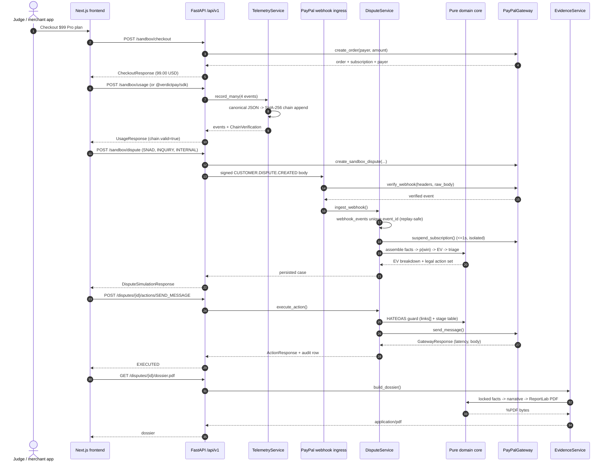
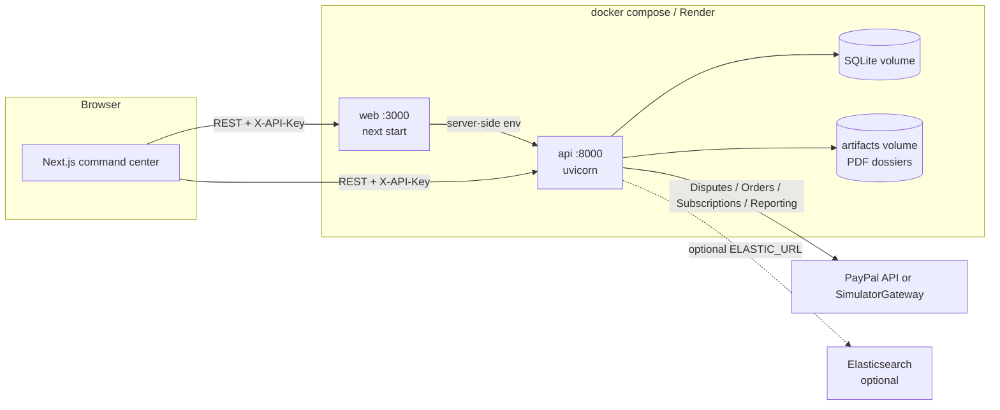

# Architecture

VerdictPay turns a merchant's own product telemetry into a cryptographically chained
system of record, prices a PayPal dispute with a deterministic EV model, and takes the
cheapest correct PayPal action through a HATEOAS state machine.

The demo path requires PayPal sandbox credentials (PAYPAL_CLIENT_ID / PAYPAL_CLIENT_SECRET); no Elastic cluster, Supabase project
or LLM key is needed: the PayPal boundary is a protocol with a live sandbox gateway, SQLite is
the default database, and the narrative layer has a template implementation.

---

## 1. Components

| Layer | Where | Responsibility |
|---|---|---|
| Judge sandbox + command center | [frontend/app](../frontend/app) | Three-button flow, live case room, triage queue, SLA board. Every response is zod-parsed in [frontend/lib/api.ts](../frontend/lib/api.ts). |
| HTTP API | [backend/app/api](../backend/app/api) | Routers mounted under `/api/v1`: health, telemetry, sandbox, disputes, evidence, webhooks, reporting. |
| Domain core | [backend/app/domain](../backend/app/domain) | Pure functions: canonical JSON + hash chain, win probability, EV, triage policy, HATEOAS state machine, fact pack, narrative, ReportLab PDF, RFC 2387 multipart. |
| Integrations | [backend/app/integrations](../backend/app/integrations) | PayPal gateway (simulator / live), narrative provider (template / optional OpenAI), dispute AI layer (Gemini classify + grounded draft, deterministic fallback), optional Elasticsearch mirror. |
| Orchestration | [backend/app/services](../backend/app/services) | `DisputeService` (webhook → case → containment → triage → action) and `EvidenceService` (dossier build/cache/upload). |
| Persistence | [backend/app/db/models.py](../backend/app/db/models.py) | Six portable SQL tables; append-only telemetry ledger with unique stream constraints. |
| TypeScript SDK | [packages/verdictpay-sdk](../packages/verdictpay-sdk) | Batched, HMAC-signed pre-dispute telemetry keyed to PayPal `payer_id` / `order_id`. |

The PayPal boundary is the only place that talks to PayPal. It is a protocol
([backend/app/domain/protocols.py](../backend/app/domain/protocols.py)) chosen by `PAYPAL_MODE` in
[backend/app/integrations/paypal/factory.py](../backend/app/integrations/paypal/factory.py), with
three modes over two implementations:

* `PAYPAL_SANDBOX` → `LivePayPalGateway` against `https://api-m.sandbox.paypal.com` — OAuth token
  cache, idempotent retries, real PayPal Disputes / Orders / Subscriptions / Reporting endpoints,
  webhook signature verification. This is the demo and E2E path: open the approval_url,
  approve as the sandbox buyer, then capture for the CREATED → APPROVED → CAPTURED lifecycle.
* Legacy local simulator path is retained in code only as a historical note, not used by the demo.
* `PAYPAL_LIVE` → the same `LivePayPalGateway` against `https://api-m.paypal.com`. It moves real
  money and refuses to start unless `ALLOW_PAYPAL_LIVE=true`.

A network mode with missing credentials builds an `UnconfiguredGateway` instead of the live client.
The app stays bootable so `/health` can name the blockers, but every payment call fails loudly and it
never substitutes a local approval. Buyer approval in the sandbox is a human action: open the approval_url, log in as the sandbox buyer, approve, then capture.

---

## 2. Request lifecycle



### 2.1 Checkout

`POST /api/v1/sandbox/checkout` calls `PayPalGateway.create_order`. The response is the
frozen `CheckoutResponse` in [backend/app/api/schemas.py](../backend/app/api/schemas.py):
`order_id`, `subscription_id`, `payer_id`, amount as a decimal string and an
`approval_url`. The simulator derives ids from stable hashes, so the same call sequence
produces the same ids.

### 2.2 Telemetry ingestion

Merchants call `@verdictpay/sdk` (or `POST /sandbox/usage` in the demo). Every event is
normalised to `TelemetryEventIn`, then `TelemetryService.record_many` appends it to the
payer's stream under a per-stream lock:

```
payload_hash = sha256(canonical_json(payload))
chain_hash   = sha256("<prev_hash>:<event_type>:<payer_id>:<created_at_utc_iso>:<payload_hash>")
```

canonical JSON is `sort_keys=True, separators=(",", ":"), ensure_ascii=False`.
Each stream starts at sequence 0 from a 64-zero genesis hash and every later row points at
its predecessor's `chain_hash`. `GET /telemetry/chain/{payer_id}/verify` recomputes the
whole stream and reports the exact broken sequence in `ChainVerification` — it never
trusts the stored hash. The contract is documented in
[backend/app/domain/telemetry/hashing.py](../backend/app/domain/telemetry/hashing.py).

### 2.3 Webhook, replay safety and containment

`POST /api/v1/webhooks/paypal` is the only unauthenticated route, because authenticity
comes from the body signature:

1. `gateway.verify_webhook(headers, raw_body)` — in live mode this is PayPal's
   `verify-webhook-signature`; in simulator mode it is HMAC-SHA256 over
   `"<unixSeconds>.<rawBody>"` with `VERDICTPAY_WEBHOOK_SECRET` and a ±300s window
   ([backend/app/security.py](../backend/app/security.py)).
2. The event id is inserted into `webhook_events` under a unique constraint; a replay
   returns the existing case instead of double-charging a side effect.
3. Containment runs before triage: `suspend_subscription` and an optional merchant hook
   are bounded by a timeout and never raise into the request path
   ([backend/app/domain/subscriptions/containment.py](../backend/app/domain/subscriptions/containment.py)).
   The case records `subscription_suspended` and the measured latency.
4. The case is upserted from the verified dispute record and triaged.

### 2.4 Facts, win probability and EV

`assemble_case_facts` locks the telemetry rows, the chain proof, ToS hash, delivery and
usage aggregates and the Visa CE 3.0 lookback (120–365 days via
`gateway.search_transactions`) into an immutable `CaseFacts` snapshot
([backend/app/domain/evidence/facts.py](../backend/app/domain/evidence/facts.py)).

Win probability is a pure weighted sum plus a reason multiplier
([backend/app/domain/disputes/win_probability.py](../backend/app/domain/disputes/win_probability.py)):

```
p = clamp(0.10 + 0.15 tos + 0.12 ip_match + 0.18 asset + 0.15 usage
          + 0.10 chain + 0.20 ce3, 0.02, 0.95) * reason_multiplier
reason_multiplier: INR 1.00, SNAD 0.90, UNAUTHORIZED 0.75
```

The EV engine ([backend/app/domain/disputes/ev.py](../backend/app/domain/disputes/ev.py))
prices fight, settle and offer in Decimal and quantizes to cents with `ROUND_HALF_UP`:

```
ratio_before  = disputes_3mo / max(sales_3mo, 1)
ratio_after   = (disputes_3mo + 1) / max(sales_3mo, 1)
high_volume   = sales_3mo >= 100 and ratio_after >= 0.015
crosses_cliff = high_volume and ratio_before < 0.015 <= ratio_after
penalty_ratio = 30 * 3 if crosses_cliff else 0
ev_fight  = p * (-30) + (1-p) * (-A - 15 - 30 - penalty_ratio)   # when high volume
ev_settle = -(A + 15) if claim_fee_attached else -A
ev_offer  = -(0.30 * A)
```

Triage ([backend/app/domain/disputes/triage.py](../backend/app/domain/disputes/triage.py))
is a first-match policy (INQUIRY deflection when evidence is strong, offer when it beats
fighting, evidence in a claim when EV-positive, settle otherwise), then degraded to a
PayPal-legal action through the state machine so the recommendation can never be illegal.

### 2.5 Actions and the HATEOAS guard

`POST /api/v1/disputes/{id}/actions/{action}` only accepts `SEND_MESSAGE`,
`MAKE_OFFER`, `ACCEPT_CLAIM`, `PROVIDE_EVIDENCE`. Before any gateway call,
[backend/app/domain/disputes/state_machine.py](../backend/app/domain/disputes/state_machine.py)
combines the frozen stage/channel table with PayPal's returned `links[]`; links can only
narrow what the table allows. An illegal action is a **422** with a machine-readable reason
(e.g. `require-evidence_link_missing`), never a silent 200. Every executed action is
persisted with an idempotency key and its measured latency in `dispute_actions`.

### 2.6 Evidence dossier (air-gapped)

`GET /disputes/{id}/dossier.pdf` and `POST .../actions/PROVIDE_EVIDENCE` share one
pipeline in [backend/app/services/evidence_service.py](../backend/app/services/evidence_service.py):

1. Lock the facts snapshot — no I/O, no LLM.
2. Compose the narrative (`TemplateNarrativeProvider` by default; an optional OpenAI
   provider receives only the locked facts and returns text) and validate that it does not
   introduce new facts ([backend/app/domain/evidence/narrative.py](../backend/app/domain/evidence/narrative.py)).
   The dispute AI layer (`POST /api/v1/disputes/{id}/ai/analyze`, idempotent
   `GET /api/v1/disputes/{id}/ai`) follows the same fence: Gemini (`GEMINI_MODEL`,
   default `gemini-2.5-flash`) only classifies the claim and drafts from the locked fact
   pack; a frozen category-to-reason map, a grounding validator and a deterministic keyword
   + template fallback (`degraded=true`) keep every number on the rules side
   ([backend/app/integrations/ai](../backend/app/integrations/ai)).
3. Render a deterministic ReportLab PDF
   ([backend/app/domain/evidence/pdf.py](../backend/app/domain/evidence/pdf.py)) and cache
   it under `ARTIFACTS_DIR`.
4. For upload, serialize an RFC 2387 `multipart/related` body — a JSON `input` part plus
   `file1` PDF — with a boundary derived from the submission identity
   ([backend/app/domain/evidence/multipart.py](../backend/app/domain/evidence/multipart.py)).
5. Send it through `gateway.provide_evidence`, recording exactly one audit row per
   idempotency key. A replay returns the original action instead of uploading twice.

No LLM output can change an amount, a probability, a hash or a timestamp: the money path is
pure and deterministic. The Gemini layer is bound by the same rule — it classifies and drafts;
EV, p(win), the recommendation and the verdict are always recomputed by the deterministic engine —
and every generation is recorded as an append-only `AI_GENERATION` chain event as provenance.

---

## 3. Trust boundaries

| # | Boundary | Control | Where |
|---|---|---|---|
| 1 | Browser → API | `X-API-Key` (or bearer), merchant scoping in every query, CORS allowlist, 256 KiB body cap | [backend/app/api/deps.py](../backend/app/api/deps.py), [backend/app/main.py](../backend/app/main.py) |
| 2 | Merchant SDK → API | `X-API-Key` authentication **and** a required HMAC signature: `X-VerdictPay-Timestamp` / `X-VerdictPay-Signature` = HMAC-SHA256 over `"<unixSeconds>.<exact raw body>"` with `VERDICTPAY_SIGNING_SECRET`, ±300 s window, verified against the raw bytes before parsing, replay-safe event ids | [packages/verdictpay-sdk/src/signing.ts](../packages/verdictpay-sdk/src/signing.ts), [backend/app/api/routers/telemetry.py](../backend/app/api/routers/telemetry.py), [backend/app/security.py](../backend/app/security.py) |
| 3 | PayPal → webhook | Signature verification (PayPal's verify-webhook-signature live, HMAC in simulator); unsigned traffic rejected unless `ALLOW_UNSIGNED_WEBHOOKS=true` **and** `APP_ENV=local`; unique `event_id` makes replay harmless | [backend/app/integrations/paypal/simulator.py](../backend/app/integrations/paypal/simulator.py), [backend/app/api/routers/webhooks.py](../backend/app/api/routers/webhooks.py) |
| 4 | API → domain core | Pure functions receive validated values and frozen dataclasses; money is Decimal, probabilities are float, external input is validated at the request model | [backend/app/domain](../backend/app/domain) |
| 5 | Domain → evidence prose | Facts are locked before the narrative layer runs; the narrative may only restate facts and is validated; PDF renderer is a pure function of facts + narrative | [backend/app/domain/evidence](../backend/app/domain/evidence) |
| 6 | Runtime → secrets | Secrets are environment-only, omitted from `Settings.describe()`, redacted in logs, never included in an error envelope or the dossier | [backend/app/config.py](../backend/app/config.py), [backend/app/logging_setup.py](../backend/app/logging_setup.py) |

**Important detail on boundary 2:** `POST /api/v1/telemetry/events` rejects an unsigned
body with `401 signature_required` and a bad/expired signature with `401 signature_invalid`;
verification uses `settings.require_signed_telemetry` (true by default) and
`VERDICTPAY_SIGNING_SECRET`. The signature covers the raw request bytes, so re-serialising
the JSON cannot be used to smuggle a change past the check. `ALLOW_UNSIGNED_WEBHOOKS` only
relaxes the **webhook** boundary, never authentication.

---

## 4. Determinism and money

* **Money** is `Decimal` everywhere; conversions happen at the HTTP boundary and are
  quantized to cents with `ROUND_HALF_UP`.
* **Probabilities** are float and clamped; the score is rounded once, at the end.
* **Hash chain** hashing uses canonical JSON and a UTC-normalised timestamp, so a value
  re-read from SQLite hashes to the same bytes it hashed to on write.
* **Pure functions** take `now` or a reference datetime as an argument; the EV,
  probability, triage and PDF modules never call `random()` or read the wall clock.
* **External ids** are derived from stable seeds in the simulator, so a demo run is
  reproducible (except for database sequence numbers after a replay).

---

## 5. Data model

Six portable SQL tables ([backend/app/db/models.py](../backend/app/db/models.py)):

| Table | Purpose | Integrity |
|---|---|---|
| `merchants` | API-key owner | unique `api_key_hash` |
| `telemetry_ledger` | append-only hash chain | unique `(merchant_id, payer_id, sequence)` and `(merchant_id, event_id)`; service + ORM guards refuse updates/deletes |
| `paypal_transactions` | Visa CE 3.0 lookback cache | unique `transaction_id` |
| `dispute_cases` | case state + EV snapshot | `dispute_id` PK, merchant-scoped reads |
| `dispute_actions` | audit log | unique `idempotency_key` |
| `webhook_events` | verified inbound events | unique `event_id` (replay-safe) |

SQLite is the default (`sqlite+aiosqlite:///./verdictpay.db`); any async SQLAlchemy URL
works, and no vendor-specific column type is used, so Postgres is a connection-string swap.

---

## 6. Failure behaviour

| Failure | Response |
|---|---|
| Missing/invalid API key | `401` `{"error":{"code":"unauthorized",...}}` |
| Request validation | `422` with per-field `details` |
| Body over 256 KiB | `413` before routing |
| Unverified webhook | `401` `webhook_verification_failed`; event not persisted |
| Illegal PayPal action for the case state | `422` `illegal_dispute_action` with a machine-readable reason |
| PayPal upstream failure | `502` `upstream_error`; the case is unchanged and the action row records the error |
| Unexpected exception | `500` with a request id and no stack trace |

The error envelope is built once in [backend/app/main.py](../backend/app/main.py) and is
identical for every route.

---

## 7. Deployment topology



* **Local / judges:** `docker compose up --build` builds
  [backend/Dockerfile](../backend/Dockerfile) and [frontend/Dockerfile](../frontend/Dockerfile),
  seeds the demo data on first boot, runs both services as non-root with healthchecks, and
  keeps SQLite and the PDFs on named volumes.
* **Render:** [render.yaml](../render.yaml) declares the two Docker services with
  `sync: false` secrets and generated signing secrets; the docs-site service is left as a
  commented block because the repository has no static-site generator.
* **Optional adapters:** Elastic is selected only when `ELASTIC_URL` is set, and the
  narrative provider only switches to OpenAI when `LLM_MODE=openai` and a key is present.
  The dispute AI layer only calls Gemini when `AI_ENABLED=true` and `GEMINI_API_KEY` is
  set (model `GEMINI_MODEL`, timeout `AI_TIMEOUT_MS`, retries `AI_MAX_RETRIES`);
  otherwise it serves the deterministic fallback. The default path is SQLite + template narrative.

---

## 8. Known limits (stated, not hidden)

* The simulator is the default and the tested path. The network gateway is covered by recorded
  fixtures, and the real sandbox has been exercised for OAuth2 and order creation
  (`artifacts/paypal-sandbox-proof.json`). Capture against the real network is not proven in this
  checkout because it needs a human to approve the order as the sandbox buyer; the verification
  script reports that as `pass_order_creation_capture_blocked` rather than claiming a capture.
* The internal test-dispute event (`POST /sandbox/dispute`, `origin: "internal_test_event"`) is not a
  PayPal-originated dispute. It travels the real ingest, triage and dossier pipeline, but PayPal did
  not create it. Only webhook- or API-originated disputes are labelled `paypal_sandbox`.
* Telemetry ingest requires an HMAC signature by default
  (`REQUIRE_SIGNED_TELEMETRY=true`); disabling it is a deliberate, local-only escape hatch.
* The Elastic adapter implements the `SearchIndex` port and is selected by configuration;
  the demo path reads SQL and never requires it.
* Bryntum and AG Studio are not redistributable; the SLA board and analytics views are
  built on open equivalents. See [sponsors.md](./sponsors.md).
