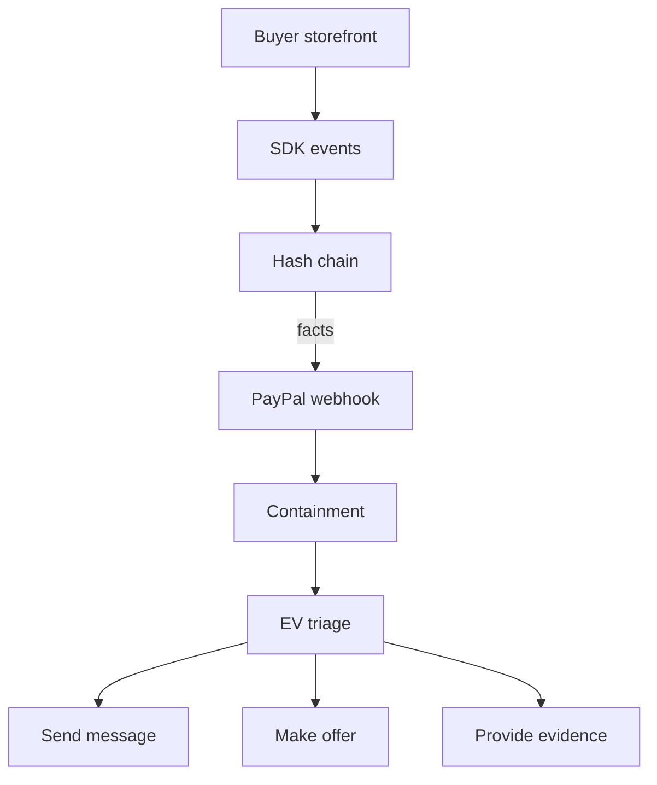
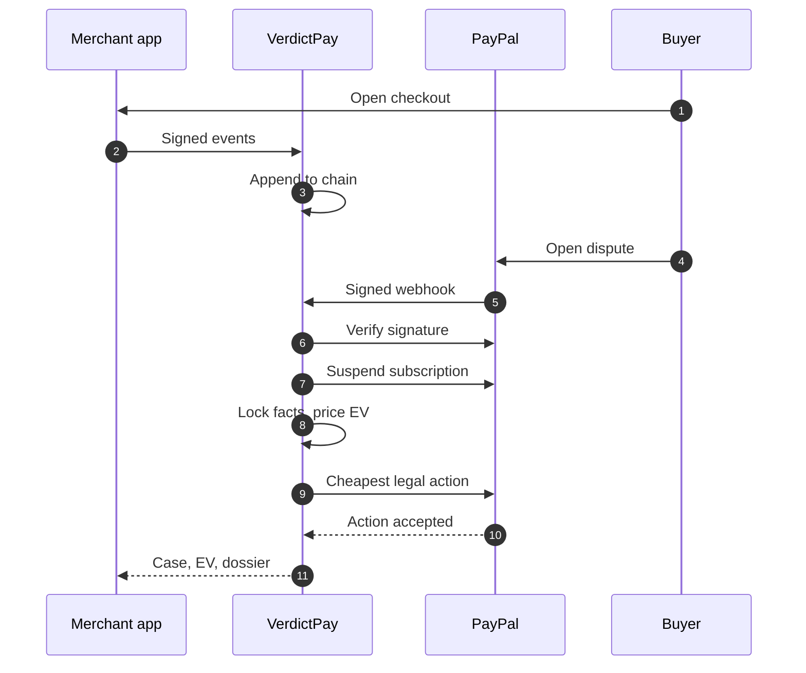

# README design spec: VerdictPay

Visual and hierarchy contract for the rewritten README. Every colour, size and rhythm below is derived from
[design/tokens.css](../design/tokens.css); this document invents no hex. Applies to the writer's live draft.

**Snapshot audited:** README.md at 174 lines / 1,951 words / 11 H2 / 3 H3 / 2 tables. The file changed twice
while this was written (277 → 306 → 174), so line numbers are indicative; section names are stable.

**Target:** 180 rendered lines, a first screen that answers name / claim / proof / run, and no claim made twice.

## 1. Hierarchy audit

| # | Problem | Evidence (current draft) | Fix |
|---|---|---|---|
| 1 | Density | L41 is one 5-sentence paragraph covering ingest → chain → webhook → containment → facts → EV → HATEOAS; L25 is 90 words, L76 is 100 | Two sentences max per paragraph, then bullets or a diagram; one idea per para |
| 2 | Repeated ideas | "no keys / no credentials" at L7, L11, L37, L90, L160; the fee-cliff story at L22, L25, L35, L60-70, L85 | Each claim gets one home: the section that proves it |
| 3 | Heading noise | 11 H2 + 3 H3, but all H3s sit under one H2 (L47, L58, L74), so "Deterministic EV" and "AI air-gap" — the two hackathon criteria — are invisible in the TOC, while a 5-bullet list gets equal-weight H2 at L80 | 12 H2s, promote the AI H3, delete "What makes it different" |
| 4 | Table overload (in the cells) | L17-23: 3 columns x 5 rows with 12-20-word cells; at 375px the middle column wraps to 4 lines and the comparison collapses into prose | 2 columns, cells <= 8 words, or 5 bold bullets |
| 5 | Weak first screen | L1-11: no mark, no banner, badges are a placeholder comment, H1 is bare text; the first runnable command is 92 lines down at L88 | Hero block with mark, badges and banner; Quickstart as section 1 |
| 6 | Inconsistent voice | "click in order" (L29) next to "Requires Python 3.12+" (L90); noun-phrase headings next to a claim heading; sentences run 8 to 90 words | Third person to describe, imperative to instruct, <= 35 words per sentence |

Two blockers outside the six: `<!-- BADGES -->` (L9) and `<!-- DIAGRAM: PIPELINE -->` (L45) ship as invisible
gaps on the page — fill or delete them before merge. The test count is asserted in three places; it is
now the measured 520 (296 pytest + 188 frontend unit + 12 frontend API + 24 SDK), re-confirmed by
collecting rather than by counting `def test_` functions, which undercounts parametrisation.

## 2. Hero spec

### 2.1 Composition, top to bottom, centred

| Element | Markup | Size | Job |
|---|---|---|---|
| Mark | `<picture>` -> mark-ink / mark-void | 56x56 | brand, not a heading |
| H1 | `<h1>VerdictPay</h1>` | GitHub H1 | the name, once |
| Tagline | `<strong>` | body | what it is, <= 14 words, no slogan |
| Body | `<p>` + `<br/>` | body | how it runs, 2 short lines |
| Proof | `<sub>` | 12px | three verifiable facts |
| Badges | 6 x flat-square | 20px tall | the trust row |
| Banner | `design/og-image.svg` at 760 | 760x399 | the poster, once |

### 2.2 Copy-paste hero

```html
<div align="center">

  <picture>
    <source media="(prefers-color-scheme: dark)" srcset="docs/assets/mark-ink.svg">
    
  </picture>

  <h1>VerdictPay</h1>

  <p><strong>Hash-chained proof, deterministic pricing, and an AI that cannot invent a number.</strong></p>

  <p>Pre-dispute telemetry for PayPal digital-goods disputes.<br/>
  Runs locally: no PayPal account, no model key, no cloud.</p>

  <p><sub>520 tests &nbsp;·&nbsp; 26 end-to-end assertions &nbsp;·&nbsp; MIT</sub></p>

  <p>
    
    
    
    
    
    <a href="LICENSE"></a>
  </p>

  

</div>
```

### 2.3 Badge rules

- Six is the cap. Order is product claim -> stack -> status: PayPal, AI, Python, Next.js, tests, license.
- `style=flat-square` on every badge, no exceptions. Never `for-the-badge`, never mixed styles.
- `labelColor=131217` on all six, so the row reads as one object in both themes.
- Two message colours only: `222224` for capability, `44A282` for verifiable status. No PayPal blue, no Python
  blue, no `000000` — an earlier draft used four colours and its black Next.js badge vanished in dark mode.
- No logos in badges: at 20px they add noise, and a wrong Simple Icons slug renders nothing.
- Em dashes and middle dots are percent-encoded (`%C2%B7`); a literal `-` in a message must be written `--`.

### 2.4 Fold math

Hero text ends near y=300. The banner adds 399px, so Quickstart's H2 lands near y=730 and its code block
starts around y=790 — visible at the bottom of a 900px viewport, one short scroll on a 768px laptop. That is
the trade accepted here: poster above, command immediately below. Do not add a third hero paragraph to
"fix" it; cut the banner to 620 if the command must clear the fold.

## 3. Visual assets plan

| File | Role | Format | Used |
|---|---|---|---|
| `design/logo-mark.svg` | source geometry, 24-unit grid, `currentColor` | SVG | never referenced directly |
| `docs/assets/mark-ink.svg` | mark for dark UI (`#ffffff`) | SVG | hero, via `<picture>` |
| `docs/assets/mark-void.svg` | mark for light UI (`#171719`) | SVG | hero, via `<picture>` |
| `design/og-image.svg` | 1200x630 banner | SVG | hero, width 760 |
| `docs/assets/og-card.png` | social / `og:image` only | PNG 1200x630 | not in README |
| `docs/assets/logo-mark.png`, `@4x` | **unusable**: baked black | PNG | delete or re-render |

### 3.1 The mark needs two files

`design/logo-mark.svg` inherits `currentColor`. In an ``, that resolves to black, so the existing
`docs/assets/logo-mark.png` is a black shield — invisible on GitHub dark (`#0d1117`) and muddy on light.
Produce two colour-locked copies (do not edit the source):

```bash
sed 's/fill="currentColor"/fill="#ffffff"/' design/logo-mark.svg > docs/assets/mark-ink.svg
sed 's/fill="currentColor"/fill="#171719"/' design/logo-mark.svg > docs/assets/mark-void.svg
```

`<picture>` swaps them with `prefers-color-scheme`, which GitHub supports and maps to the reader's theme.
Without `<picture>`, keep the mark out of the README entirely rather than ship an invisible one.

### 3.2 SVG in the README, PNG for social

Ship the banner as SVG: 5 KB instead of 90 KB, sharp at 760 on a 2x display, and one source of truth with the
design file. Keep `og-card.png` because `og:image` and most social parsers will not accept SVG, and because it
is the fallback if a corporate proxy blocks SVG. Re-render the PNG after any SVG edit, with Public Sans installed so
the headline matches the brand face.

### 3.3 GitHub SVG caveats

- `currentColor` is black in ``; there is no page colour to inherit. Hence 3.1.
- No external fonts load. Public Sans falls back to the system sans; absolute coordinates mean no reflow, only
  slightly different letterforms. Accept it, or bake the wordmark to paths in a copy.
- Scripts and external references are inert. These assets are already self-contained; keep them so.
- Camo caches by URL. When the art changes, rename the file rather than overwrite it.

## 4. Two diagrams

Both replace the `<!-- DIAGRAM: PIPELINE -->` placeholder. Rule for both: <= 9 nodes or 4 participants, labels
<= 3 words, no `%%{init}%%`, no `classDef`, no `style`, no `linkStyle`, no emoji. GitHub strips or ignores
all of them, and a wide LR graph shrinks to unreadable on a phone — use TD.

### 4.1 Pipeline



### 4.2 Dispute lifecycle



## 5. Section rhythm

Twelve H2s, no `---` separators (GitHub already draws a rule under every H2). Budget is source lines.

| # | Section | Treatment | Lines |
|---|---|---|---|
| - | Hero | HTML block from 2.2 | 22 |
| 1 | Quickstart | H2, one sentence, one bash block (5), Docker + demo-proof in `<details>` | 20 |
| 2 | The 60-second demo | H2, one sentence, 2-column table, 3 rows, cells <= 10 words | 14 |
| 3 | Why this exists | H2, one sentence, 5 bold bullets, blockquote for the $25 / -$5 example | 13 |
| 4 | How it works | H2, 2 sentences, flowchart, one 4-line `text` block for the EV identity | 24 |
| 5 | Dispute lifecycle | H2, 1 sentence, sequenceDiagram | 20 |
| 6 | The AI air-gap | H2, 3 bullets, blockquote with the provenance footer | 10 |
| 7 | API surface | H2, 4 bullets for the demo routes, table inside `<details>` | 7 |
| 8 | Security model | H2, 4 bullets | 8 |
| 9 | Verification | H2, one bash block (3), one sentence | 11 |
| 10 | Sponsor honesty | H2, 3-column status table (7 rows), 1 caveat sentence | 12 |
| 11 | Hackathon | H2, 2 sentences, one link line | 7 |
| 12 | Limitations + license | H2, 4 bullets, one license line | 12 |

Total 180 rendered lines, from 174 today plus two diagrams, minus the section and sentences cut in 9.

## 6. Tables vs cards

- **Table** when >= 3 items share >= 2 attributes the reader compares, and every cell fits one line at 375px.
- **Bullets** when each row is a claim with its own caveat — a column of sentences is a bullet list in disguise.
- **`<details>`** when the content is reference lookup after the decision (endpoints, env vars), not part of
  the argument. Hidden content is still indexed and searchable on GitHub.

Applied: **API surface** is a table, but closed — nobody reads 10 endpoints before trusting the repo; the four
routes that carry the demo stay visible as bullets. **Sponsor honesty** is a table with a Status column
(Implemented / Adapter / Not used), because that axis *is* the honesty claim; cells <= 12 words, caveat in prose
underneath. **Limitations** stays bullets — a table would invent a second column that does not exist.

## 7. GitHub constraints

| Renders | Does not render |
|---|---|
| Mermaid fences, re-themed by the site theme | `%%{init}%%`, `classDef`, `style`, `linkStyle` |
| `<details>` / `<summary>` | `<style>`, `style=`, `class=`, `id=` |
| `<div align>`, `<p align>`, `<h1>` | inline `<svg>` — stripped; must be a file |
| `<picture>` + `prefers-color-scheme` | custom fonts; no web font can be loaded |
| repo-relative SVG and PNG via `` | raw HTML tables with borders or padding |
| markdown tables with a header row | `rowspan` / `colspan` in markdown tables |
| shields.io badges, cached by camo | SVG animation or JS inside badges |
| `<sub>`, `<code>`, `<kbd>`, `<br/>` | colouring text or headings by any means |

**Dark mode.** The mark is the only element that must swap; everything else is theme-neutral or deliberately
dark. Mermaid re-themes itself, so verify node text in both themes and never hard-code fills. Screenshots of the
dark UI need a 1px `rgba(255,255,255,0.08)` border baked into the PNG, or they float borderless on a light page.
The OG card is dark by brand; cap it at 760 so it reads as a card rather than a page.

## 8. Accessibility

- Alt text: the banner states the claim and the chip text; the mark is `alt=""` (decorative, the H1 names the
  product). Never "image of" and never the filename.
- Link text: badge alt is the meaning ("License: MIT", "520 tests passing"), not "badge" or "here"; file links
  name the file (`hashing.py`, not "this file").
- Heading order: one H1, twelve H2, at most two H3, no H4. `<summary>` is a disclosure label, not a heading.
- Tables: a header row always, no empty header cell, sentence-case heads, three columns maximum.
- Colour is never the only signal: positive means verified or preserved, and every colour cue also carries a word
  ("Implemented", "Not used") — the earlier compliance table's check-mark column is exactly what not to do.
- Diagrams: one sentence before each carries the meaning, because Mermaid renders as an image to assistive tech;
  the prose must stand alone if the diagram fails.

## 9. Before and after

| Now (174 lines) | Proposed | Lines |
|---|---|---|
| L1-11 hero as plain text, badges missing | Hero block, 6 badges, 760px banner | 22 |
| L13 Why this exists, 3-column table | 3 Why, bullets + blockquote | 13 |
| L27 The 60-second demo, 2-column table | 2 Demo, tighter cells | 14 |
| L39 How it works: 3 H3s, 40 lines of prose | 4 How it works + 5 Dispute lifecycle (split) | 24 + 20 |
| L80 What makes it different, 5 bullets | **cut** — folded into 3 and 4 | 0 |
| L88 Quickstart, 27 lines, 3 bash blocks | 1 Quickstart, one block + 2 `<details>` | 20 |
| L115 API surface (already `<details>`) | 7 API surface, unchanged, plus 4 visible bullets | 7 |
| L141 Security model | 8 Security model | 8 |
| L148 Verification | 9 Verification | 11 |
| L158 Limitations (4) | 12 Limitations + license (merged) | 12 |
| L166 Sponsors as one sentence | 10 Sponsor honesty, status table | 12 |
| L168 Hackathon | 11 Hackathon | 7 |
| L172 License | merged into 12 | 0 |

**Cuts:** "What makes it different" (15 lines, every bullet repeats 4 or 3); the four duplicate zero-key
sentences; three duplicate fee-cliff paragraphs; both placeholder comments; the merged License section. **Moves:**
Quickstart from position 5 to 1, so the first runnable command is inside the first scroll.